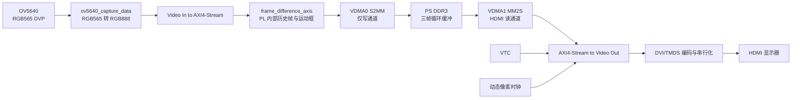
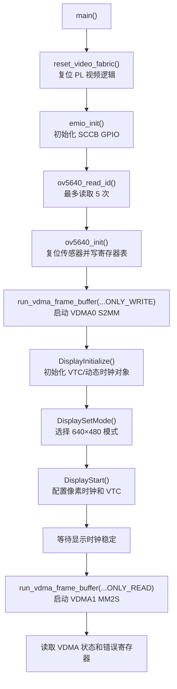
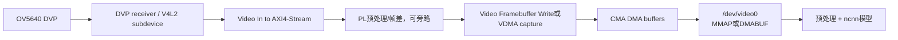
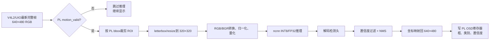

# STUDYBOARD Zynq-7020 + OV5640 + HDMI 帧差检测新手教程

> 适用硬件：正点原子 Zynq-7020 最小系统板（XC7Z020-2CLG400）与兼容的 OV5640 DVP 摄像头模块  
> 适用软件：Xilinx Vivado 2018.3、Xilinx SDK 2018.3  
> 当前工作模式：OV5640 640×480、RGB565 输入、RGB888 内部处理、HDMI 640×480@60 Hz 输出  
> 当前程序标识：`STUDYBOARD OV5640 PL-history motion build`

## 1. 这份教程解决什么问题

原 GitHub 仓库展示了一个基于 Zynq、OV5640、VDMA 和 HDMI 的帧差运动检测项目，但仓库并不是一个能够直接在 Vivado 中打开和生成 bitstream 的完整工程。原始内容缺少 `.xpr`、Block Design、顶层 wrapper、部分 Xilinx IP 生成物、硬件平台 HDF 和可直接使用的 BSP。

本仓库目前已经完成以下工作：

- 根据 STUDYBOARD 原理图重建 Zynq-7020 Vivado 2018.3 工程。
- 为 OV5640 DVP、SCCB 和 HDMI TMDS 编写本板 XDC 引脚约束。
- 恢复 PS 端 DDR3、UART0、QSPI、GPIO EMIO、AXI GP0、HP0 和 HP1 配置。
- 重建 OV5640 采集、AXI4-Stream、VDMA、VTC、动态像素时钟和 HDMI 数据通路。
- 修复 PL 视频逻辑复位、VDMA 初始化、HDMI VDMA AXI 访问和 genlock 冻结问题。
- 将不稳定的 DDR 反馈帧差改为 PL 内部相邻帧灰度采样历史。
- 完成 Vivado 综合、实现、DRC、时序检查和 SDK standalone 程序构建。
- 已在实物板上实现 OV5640 实时采集和完整 HDMI 刷新。

这份文档既是运行说明，也是一个从硬件信号、AXI 视频流、DDR 帧缓存到帧差算法的分层入门教程。

### 阅读路线

这份文档较长，建议按目标阅读：

| 目标 | 建议章节 |
| --- | --- |
| 直接把当前版本运行起来 | 第 7~13 节 |
| 理解完整像素数据流和通信协议 | 第 3~6 节 |
| 排查黑屏、冻帧、颜色和运动框 | 第 11、15 节 |
| 修改帧率、分辨率和画质 | 第 14、17 节 |
| 从零重建 Vivado/SDK工程 | 第 8、12、16 节 |
| 迁移 PetaLinux/Linux | 第 21~23 节 |
| 部署轻量 YOLO/ncnn | 第 24~26 节 |

文中“当前值”表示已经随本仓库源码构建并在实物上验证；“建议值/示例”表示后续开发路线，必须重新构建和实测，不能视为现成可用的生成物。

## 2. 最终实现的功能

系统上电并运行 ARM 程序后，会完成以下工作：

1. PL 向 OV5640 提供 24 MHz `XCLK`。
2. PS 通过 GPIO EMIO 模拟 SCCB，读取 OV5640 芯片 ID 并写入初始化寄存器。
3. OV5640 输出 640×480 RGB565 DVP 视频。
4. PL 将两个 8 位摄像头字节拼成 RGB565，再扩展为 RGB888。
5. Video In to AXI4-Stream IP 将原生视频转换成 AXI4-Stream。
6. 帧差模块在 PL 内保存上一帧的 80×60 灰度采样，检测相邻帧的运动区域。
7. 帧差模块把白色矩形框叠加到当前 RGB888 视频上。
8. VDMA0 的 S2MM 通道将处理后的画面写入 PS DDR3。
9. VDMA1 的 MM2S 通道从 DDR3 读出画面。
10. AXI4-Stream to Video Out、VTC 和 DVI/TMDS 模块生成 HDMI 输出。

这里的“运动检测”不是目标识别或人工智能。系统不知道画面里是人、车辆还是其他物体，只能判断某些区域相对上一帧发生了明显灰度变化。

## 3. 系统总体结构

### 3.1 当前有效的视频数据通路



### 3.2 PS 与 PL 的职责

| 部分 | 主要职责 |
| --- | --- |
| PS / Cortex-A9 | 运行 standalone C 程序；复位 PL 视频逻辑；通过 SCCB 配置 OV5640；配置 VDMA、VTC 和动态像素时钟；打印串口诊断信息 |
| PL / FPGA | 产生摄像头时钟；接收 DVP 视频；转换 AXI4-Stream；执行帧差检测和矩形框叠加；通过 VDMA 访问 DDR；生成 HDMI TMDS 信号 |
| PS DDR3 | 保存处理后的 RGB888 帧，连接摄像头处理链和 HDMI 显示链 |

### 3.3 控制通路与数据通路

初学者需要区分以下三种 AXI 用途：

| 接口 | 用途 | 本项目中的例子 |
| --- | --- | --- |
| AXI4-Lite | 低带宽寄存器配置 | PS 通过 `M_AXI_GP0` 配置 VDMA0、VDMA1、VTC 和动态时钟 |
| AXI4 Memory-Mapped | 高带宽 DDR 读写 | VDMA0 通过 HP0 写 DDR；VDMA1 通过 HP1 读 DDR |
| AXI4-Stream | 像素连续传输，不带内存地址 | Video In、帧差模块、VDMA 和 Video Out 之间的视频流 |

当前设计把 HDMI VDMA1 独立连接到 PS `S_AXI_HP1`。这样 HDMI 读数据不会与 VDMA0 写数据共同争用 HP0，避免了曾经出现的 VDMA1 `ERR=0x020` AXI Slave Error。

## 4. 必须理解的基础知识

### 4.1 OV5640 的两类接口

OV5640 同时使用控制接口和视频数据接口：

- SCCB：功能类似 I²C，用于读写摄像头寄存器。当前由 PS GPIO EMIO 软件模拟。
- DVP：并行视频接口，包括 `D[7:0]`、`PCLK`、`HREF` 和 `VSYNC`。

其他控制信号：

- `XCLK`：FPGA 提供给摄像头的 24 MHz参考时钟。
- `PWDN`：高电平休眠，当前 PL 固定输出低电平。
- `RESET_N`：低电平复位，当前 PL 固定输出高电平。

摄像头寄存器 `0x4300=0x61` 将输出配置成 RGB565。一个像素为 16 位，而 DVP 数据口只有 8 位，所以需要两个 `PCLK` 周期传输一个像素。

### 4.2 RGB565 与 RGB888

RGB565 使用 16 位表示一个像素：

```text
[15:11] 红色 5 位
[10:5]  绿色 6 位
[4:0]   蓝色 5 位
```

`ov5640_capture_data.v` 将 RGB565 扩展成 24 位 RGB888：

```text
[23:16] R
[15:8]  G
[7:0]   B
```

这种扩展不会创造新的颜色精度，只是将低位补零，使后级统一使用 24 位像素接口。

需要区分“RTL 位字段含义”和“CPU 内存字节顺序”。上述 24 位信号在
Verilog 中是 `{R,G,B}`，但 Zynq ARM 是小端序：VDMA 写入 DDR 后，
CPU 按低地址到高地址读到的三个字节是 `B,G,R`。2026-09-21 的
Linux 冻结帧验证中，三帧均为 921600 字节且 BGR 解释颜色正常，
因此本工程的用户态格式应记为 `BGR24`；未来 V4L2 接口应枚举
`V4L2_PIX_FMT_BGR24`。这不表示 PL 内部颜色通道连错，只是位向量与
小端存储的视角不同。

### 4.3 AXI4-Stream 视频信号

本项目的 AXI4-Stream 每拍传输一个 24 位 RGB888 像素。最重要的信号是：

| 信号 | 含义 |
| --- | --- |
| `TDATA[23:0]` | 当前 RGB888 像素 |
| `TVALID` | 发送端声明当前像素有效 |
| `TREADY` | 接收端能够接收当前像素 |
| `TVALID && TREADY` | 一个像素真正完成传输 |
| `TUSER` | 每帧第一个像素，即 SOF（Start Of Frame） |
| `TLAST` | 每行最后一个像素，即 EOL（End Of Line） |

像素计数器只能在 `TVALID && TREADY` 时更新。如果只看 `TVALID`，下游一旦施加 backpressure，就会出现像素坐标错位、丢行或矩形框漂移。

### 4.4 VDMA 的 MM2S 和 S2MM

VDMA 是视频专用 DMA：

- S2MM：Stream to Memory-Mapped，把 AXI4-Stream 视频写入 DDR。
- MM2S：Memory-Mapped to Stream，从 DDR 读出视频并形成 AXI4-Stream。

当前运行方式为：

- VDMA0：仅启动 S2MM，把带运动框的摄像头画面写入 DDR。
- VDMA1：仅启动 MM2S，把 DDR 画面送到 HDMI。

Vivado Block Design 中仍保留 VDMA0 MM2S 和帧差模块 `S1_AXIS` 连接，这是为了兼容原始工程结构；当前 `frame_difference_axis.v` 不再使用该参考流，软件也不会启动 VDMA0 MM2S。

### 4.5 VTC、像素时钟和 HDMI

HDMI 显示不仅需要有效像素，还需要完整的水平、垂直消隐和同步时序：

- VTC 产生 640×480@60 Hz 的视频时序。
- `axi_dynclk` 根据显示模式产生像素时钟。
- 当前 640×480 模式像素时钟设为约 25.12 MHz。
- DVI 编码器把 R、G、B 三个通道编码成 10 位 TMDS 数据。
- 10:1 串行器使用 5 倍像素时钟的 DDR 输出完成 TMDS 串行发送。

### 4.6 时钟域和复位

本工程至少有三个重要时钟域：

| 时钟 | 频率 | 用途 |
| --- | --- | --- |
| `FCLK_CLK0` | 100 MHz | AXI 控制、VDMA、帧差和大部分 PL 数据通路 |
| `cam_xclk` | 24 MHz | 提供给 OV5640 的参考时钟 |
| `cam_pclk` | 约 72 MHz | OV5640 输出 DVP 字节的采样时钟 |
| HDMI pixel clock | 约 25.12 MHz | 640×480 视频输出 |

Video In 和 Video Out IP 都启用了异步时钟支持。各时钟域还分别使用 `proc_sys_reset` 进行同步复位释放。

### 4.7 SCCB 的一笔寄存器读写到底发生了什么

OV5640 使用 16 位寄存器地址和 8 位寄存器数据。源码中的 `SCCB_ID` 为 `0x78`，这是包含最低位读写位的 8 位写地址；读地址为 `0x79`。如果以后改用 Linux I²C API，通常应填写去掉读写位后的 7 位地址 `0x3c`，不要继续填写 `0x78`。

写一个寄存器时，`sccb_write_reg16(addr, data)` 的总线顺序是：

```text
START
  -> 0x78（器件写地址）
  -> addr[15:8]（寄存器地址高字节）
  -> addr[7:0]（寄存器地址低字节）
  -> data（8 位数据）
STOP
```

读取一个寄存器时，`sccb_read_reg16(addr)` 先用写方向发送 16 位子地址，再切换到读方向：

```text
START -> 0x78 -> addr[15:8] -> addr[7:0] -> STOP
START -> 0x79 -> 读取 8 位数据 -> STOP
```

底层函数与作用如下：

| 函数 | 作用 | 关键行为 |
| --- | --- | --- |
| `emio_init()` | 初始化 PS GPIO/EMIO | SCL、SDA 设为输出并拉高 |
| `sccb_start()` | 产生开始条件 | SCL 为高时，SDA 从高变低 |
| `sccb_stop()` | 产生停止条件 | SCL 为高时，SDA 从低变高 |
| `sccb_send_byte()` | 发送 8 位数据 | 高位先发，每一位由一次 SCL 高脉冲锁存 |
| `sccb_rece_byte()` | 接收 8 位数据 | 暂时把 SDA 切为输入，逐位采样 |
| `sccb_ack()` | 当前代码产生一个低电平应答时隙 | **它没有读取从机 ACK** |
| `emio_read_scl/sda()` | 读取总线电平 | 用于上电诊断和排查短路/上拉 |

当前驱动每个半周期附近使用数微秒延时，速度远低于视频数据通路，因此 SCCB 只适合上电配置和偶尔改参数，不用于传输图像。

> 重要限制：当前 `sccb_ack()` 由 PS 主动把 SDA 拉低，并未释放 SDA 后采样 OV5640 是否应答。因此串口中的“register configuration successful”表示整张寄存器表已经执行结束，并不等于每个寄存器写入都得到了传感器 ACK。若要增强可靠性，应新增 `sccb_wait_ack()`：发送完 8 位后把 SDA 切为输入，在第 9 个 SCL 高电平采样 SDA，低电平才算 ACK，超时则终止并打印失败寄存器地址。Linux 阶段更推荐使用内核 I²C、`i2c-gpio` 或 AXI IIC 驱动完成标准 ACK 检查。

### 4.8 DVP 的帧、行、字节和像素关系

DVP 是无地址、连续时序接口。接收端不是主动“请求一个像素”，而是跟随摄像头输出：

1. `VSYNC` 表示一帧边界；其有效极性由 OV5640 配置和采集 RTL约定。
2. `HREF` 有效期间是当前行的有效图像数据。
3. 每个 `PCLK` 有效边沿采样一次 `D[7:0]`。
4. RGB565 每像素 16 位，所以采集模块把相邻两个 8 位字节拼成一个像素。
5. 拼接后的像素扩展为 RGB888，并生成 `vid_active_video`、`vid_hblank`、`vid_vblank` 等原生视频控制信号。
6. Video In to AXI4-Stream 再把原生视频时序转换成带 `TUSER/TLAST` 的流。

这一层最常见的错误是字节相位错一拍：如果在一行中漏掉或多取一个 DVP 字节，后面像素的高低字节都会错位，表现为颜色严重异常或整行花屏。用 ILA 调试时至少观察 `PCLK`、`VSYNC`、`HREF`、`D[7:0]`、字节奇偶标志和输出像素有效信号。

### 4.9 AXI4-Stream 的反压如何沿数据流传播

`TREADY=0` 表示下游暂时没有空间，发送端必须保持 `TDATA/TUSER/TLAST` 不变并继续保持 `TVALID=1`，直到握手成功。当前帧差模块采用透明流式结构：

```text
s0_axis_tready = m0_axis_tready
```

因此 VDMA0 一旦停止接收，反压会向前传到帧差模块和 Video In。Video In 内部异步 FIFO 可以吸收短暂波动，但不能吸收无限时间的停顿；FIFO 溢出就会破坏帧。修改 RTL 时必须让所有像素坐标、历史 RAM 更新、运动点计数都以 `TVALID && TREADY` 为唯一前进条件。

### 4.10 AXI-Lite、HP 端口和 DDR 地址的完整关系

PS 通过 `M_AXI_GP0` 发起 AXI-Lite 配置访问。它只写 VDMA、VTC、动态时钟等 IP 的控制寄存器，不搬运整帧图像。真正的帧数据由 VDMA 的 AXI Memory-Mapped 主接口发起：

```text
VDMA0 S2MM -> AXI Interconnect -> PS S_AXI_HP0 -> DDR 控制器 -> DDR3
DDR3 -> PS S_AXI_HP1 -> AXI Interconnect -> VDMA1 MM2S
```

HP0/HP1 是从 PL 视角命名的 PS 高性能从端口：PL 中的 VDMA 是总线主设备，PS 的 HP 端口接受其突发读写请求。Cortex-A9 不需要逐像素复制画面，只负责把帧地址、行字节数、步长和行数写入 VDMA 寄存器。

### 4.11 HDMI/DVI 中“分辨率”和“刷新率”的含义

显示端的 640×480@60 并不表示摄像头也必须输出 60 fps。VTC 每秒产生约 60 个显示帧时序，VDMA1持续读取 DDR 中的最新帧；若摄像头约 30 fps，通常同一摄像头帧会被 HDMI 显示两次。二者由 DDR 帧缓存解耦：

```text
摄像头帧率：由 OV5640 PLL、HTS、VTS、曝光等决定
HDMI 刷新率：由显示模式、VTC 和像素时钟决定
```

修改摄像头帧率通常不需要修改 HDMI 刷新率；修改 HDMI 分辨率则必须同步修改 VTC 模式、像素时钟、VDMA 行宽以及上游图像尺寸。

## 5. 当前帧差检测算法

当前有效实现位于：

```text
rtl/frame_difference_axis.v
```

### 5.1 为什么不再直接用 DDR 上一帧

原始算法让 VDMA0 一边向三帧缓冲写当前处理帧，一边从同一组循环缓冲读“上一帧”。在关闭 genlock 后，读写帧索引不再严格同步，读通道可能读到正在写入的帧，导致空间位置不对应。结果是画面能够实时刷新，但大量像素被错误判定为变化，矩形框几乎覆盖全屏。

如果重新打开 genlock，当前数据流又会形成启动依赖：帧差输出等待上一帧，而上一帧读写状态又等待视频帧同步，最终表现为画面停在某一帧。

新版算法在 PL 内部保存低分辨率历史，不再依赖 DDR 参考读通道，从结构上消除了这个循环依赖。

### 5.2 80×60 采样网格

640×480 画面按 8×8 像素分块：

```text
640 / 8 = 80
480 / 8 = 60
```

每个 8×8 块只在中心附近取一个像素，因此一帧只保存 4800 个灰度样本。上一帧灰度约占 4.8 KiB，差异标志图约占 600 B。

### 5.3 灰度近似

为了避免浮点乘法，使用以下近似：

```text
Y ≈ 0.25R + 0.5G + 0.25B
```

RTL 中通过移位和加法实现，不需要复杂浮点运算。

### 5.4 差异阈值

同一个采样位置计算相邻两帧灰度绝对差：

```text
diff = abs(current_luma - previous_luma)
```

当 `diff > 40` 时，该采样点被标记为原始运动点。阈值定义为：

```verilog
localparam [7:0] DIFF_THRESHOLD = 8'd40;
```

阈值越小越灵敏，也越容易把噪声、自动曝光和灯光闪烁当成运动；阈值越大越稳定，但可能漏掉低对比度或移动缓慢的目标。

### 5.5 空间去噪

一个原始运动点还必须与左侧或上侧的另一个运动点相邻，才会被确认。这样可以去掉孤立的传感器噪点。

当前算法没有实现完整的腐蚀、膨胀或连通域分析，但对入门级实时检测已经比“任何一个差异像素都扩大矩形框”稳定得多。

### 5.6 运动框生成

系统统计一帧中所有确认运动点的最左、最右、最上和最下位置，形成全局外接矩形，并向外扩展一个 8 像素块。

只有确认采样数满足以下条件时才显示：

```text
2 <= motion_sample_count <= 1000
```

- 小于 2：认为是孤立噪声。
- 大于 1000：认为是自动曝光、镜头遮挡或场景整体突变，取消整屏框。

矩形框宽度为 2 像素，颜色使用 `24'hffffff` 白色。使用白色是为了避免板级 HDMI 通道顺序不一致时红框显示成其他颜色。

### 5.7 算法限制

- 小于采样间距的目标可能被漏检。
- 目标停止移动后，框会消失，这是帧差法的正常行为。
- 框使用上一帧完成的检测结果，因此视觉上可能滞后一帧。
- 多个运动目标会被一个大外接矩形包围。
- 摄像头快速晃动会让整个场景发生变化，可能触发场景突变抑制。
- 当前算法不能区分人、车辆或其他类别。

### 5.8 一帧在算法模块中的逐步处理

下面按时间顺序说明 `frame_difference_axis.v` 的实际行为：

1. 接收到握手成功的 `TUSER` 像素后，坐标归零，新一帧开始，并把上一帧算出的边界框转为本帧显示框。
2. 每接受一个像素，利用 `TLAST` 和内部横纵计数器更新 `(x,y)`。
3. 当 `x[2:0]==4` 且 `y[2:0]==4` 时，当前像素是一个 8×8 块的采样点。
4. 用移位加法计算近似灰度，并从 `previous_luma[grid_y*80+grid_x]` 读出同位置上一帧样本。
5. 计算绝对差，与 `DIFF_THRESHOLD` 比较，形成 `raw_motion`。
6. 查询 `difference_map` 中左侧和上侧采样点；至少相邻一个变化点才形成 `confirmed_motion`。
7. 把当前灰度和原始差异标志写回两块历史存储，为下一帧使用。
8. 若运动点得到确认，则更新最小/最大网格坐标和运动点计数。
9. 到达一帧末尾后，检查运动点数量是否位于有效区间；有效时把网格边界换算为像素边界并外扩 8 像素。
10. 对当前输出像素判断是否位于矩形框的四条边；若是则把 RGB 替换为白色，否则原样透传。

检测框使用“上一帧完成的统计结果”叠加到“下一帧输出”上，这是流式算法避免缓存整帧的常用方法。代价是一帧延迟；好处是只需要约 5.4 KiB历史状态，不需要在 PL 内保存 640×480×3 字节整帧。

### 5.9 算法参数怎样调

| 参数 | 当前值 | 调小的效果 | 调大的效果 |
| --- | ---: | --- | --- |
| `SAMPLE_SHIFT` | 3，即 8×8 | 网格更密、定位更准、历史 RAM 增加 | 网格更稀、资源减少、小目标更易漏掉 |
| `DIFF_THRESHOLD` | 40 | 更灵敏，噪声/曝光误检增加 | 更稳定，低对比运动易漏检 |
| `MIN_MOTION_SAMPLES` | 2 | 更容易出框 | 抑制小噪声，也可能漏掉小目标 |
| `MAX_MOTION_SAMPLES` | 1000 | 更容易把大范围变化当场景突变抑制 | 快速移动或遮挡时可能出现大框 |
| 边界外扩 | 8 px | 框更贴近采样点 | 框包含更多目标边缘 |

推荐每次只修改一个参数，录制相同场景进行对比，并记录静止误检、慢速移动、小目标和镜头遮挡四类结果。参数修改后必须重新综合并生成 bitstream，因为这些值是 RTL 常量，不是 ARM 运行时寄存器。

若希望以后在 Linux 或串口中在线调参，应给帧差模块增加 AXI4-Lite 从接口，把阈值、最小点数、最大点数和框颜色改成可写寄存器；同时增加只读寄存器输出 `motion_valid`、`bbox_x0/y0/x1/y1` 和 `frame_counter`。这也正是把帧差检测作为 YOLO 前级“运动门控”的关键接口。

## 6. 工程目录说明

```text
ZYNQ_ov5640_hdmi_frame_difference-master/
├─ bringup/
│  └─ hdmi_colorbar/               # 不依赖 ARM 的 HDMI 彩条测试
├─ constraints/
│  └─ studyboard_top.xdc           # 当前 STUDYBOARD 相机与 HDMI 引脚约束
├─ docs/
│  ├─ studyboard_porting.md        # 早期移植记录，部分状态已过时
│  └─ STUDYBOARD_OV5640_帧差项目新手教程.md
├─ ip_repo/
│  ├─ axi_dynclk_v1_0/             # 动态 HDMI 像素时钟 IP
│  ├─ DVI_TX/                      # DVI/TMDS 编码和串行化 IP
│  ├─ ov5640_cap_data/             # RGB565 DVP 采集 IP
│  └─ rgb2lcd/                     # 原仓库保留的 LCD IP，当前 HDMI 通路未使用
├─ ov5640_hdmi.srcs/
│  └─ sources_1/imports/project/
│     ├─ AXI_VIP_Frame_Difference.v # 原始 DDR/FIFO 帧差源码，当前未实例化
│     └─ RGB888_YCbCr444.v          # 原始颜色转换源码，当前新版算法未实例化
├─ rtl/
│  └─ frame_difference_axis.v      # 当前真正使用的帧差、去噪和矩形框 RTL
├─ scripts/
│  ├─ check_vivado_environment.tcl # 检查器件和必要 Xilinx IP
│  ├─ build_hdmi_colorbar.tcl      # 构建独立 HDMI 彩条 bitstream
│  ├─ create_studyboard_project.tcl# 从源码重建完整 Vivado Block Design
│  ├─ build_studyboard_project.tcl # 综合、实现并导出 bit/HDF
│  └─ build_studyboard_sdk.tcl     # 创建/构建 SDK standalone 应用
├─ SDK/ov5640_hdmi_frame_difference/src/
│  ├─ main.c                       # ARM 程序入口和初始化顺序
│  ├─ emio_sccb_cfg/               # GPIO EMIO 模拟 SCCB
│  ├─ ov5640/                      # OV5640 寄存器配置
│  ├─ vdma_api/                    # VDMA 初始化与帧缓冲配置
│  ├─ display_ctrl_hdmi/           # VTC 和显示模式配置
│  ├─ dynclk/                      # 动态像素时钟配置
│  └─ lscript.ld                   # standalone 链接脚本
├─ build/                          # 自动生成工程和 SDK workspace，不建议手工改
├─ output/
│  ├─ bit/                         # HDMI 彩条 bitstream
│  └─ full/                        # 完整项目 bit、ELF、HDF 和 HWDEF
└─ readme.md                       # 原项目说明
```

### 6.1 应该修改哪些文件

日常开发应修改：

- PL 算法：`rtl/frame_difference_axis.v`
- 软件流程：`SDK/ov5640_hdmi_frame_difference/src/main.c`
- OV5640 寄存器：`SDK/ov5640_hdmi_frame_difference/src/ov5640/ov5640_init.c`
- VDMA 参数：`SDK/ov5640_hdmi_frame_difference/src/vdma_api/vdma_api.c`
- HDMI 模式：`SDK/ov5640_hdmi_frame_difference/src/display_ctrl_hdmi/lcd_modes.h`
- Block Design：`scripts/create_studyboard_project.tcl`
- 板级引脚：`constraints/studyboard_top.xdc`

不要只修改 `build/` 下的自动生成文件，因为再次执行工程创建脚本后，这些修改会丢失。

### 6.2 ARM 软件启动调用链

`main.c` 的执行顺序不是随意排列的。当前有效调用链如下：



先启动写通路、再建立 HDMI 时序、最后启动 HDMI 读通路，是当前实测稳定的顺序。若先启动 VDMA1，而 Video Out 的像素时钟/VTC尚未稳定，读通道可能立即遇到停顿或错误。

### 6.3 主要 C 函数速查

| 函数 | 文件 | 输入/输出 | 在本项目中的作用 |
| --- | --- | --- | --- |
| `reset_video_fabric()` | `main.c` | 无 | 通过 SLCR `FPGA_RST_CTRL` 复位 PL 复位域，清理 JTAG重复运行后的 VDMA状态 |
| `ov5640_read_id()` | `ov5640_init.c` | 返回 16 位 ID | 读取 `0x300a/0x300b`，期望 `0x5640` |
| `ov5640_init(w,h,hts,vts)` | `ov5640_init.c` | 模式参数，返回状态 | 软件复位 OV5640，配置 PLL、ISP、RGB565、窗口和时序 |
| `run_vdma_frame_buffer()` | `vdma_api.c` | VDMA实例、宽高、基址、模式 | 查找配置、复位通道、写读通道参数并启动传输 |
| `WriteSetup()` | `vdma_api.c` | VDMA上下文 | 设置 S2MM 的 VSIZE、HSIZE、STRIDE和三帧地址 |
| `ReadSetup()` | `vdma_api.c` | VDMA上下文 | 设置 MM2S 的 VSIZE、HSIZE、STRIDE和三帧地址 |
| `StartTransfer()` | `vdma_api.c` | VDMA上下文、方向 | 提交缓冲地址并启动对应通道 |
| `DisplayInitialize()` | `display_ctrl.c` | VTC ID、dynclk地址 | 初始化显示控制结构和 VTC 驱动 |
| `DisplaySetMode()` | `display_ctrl.c` | `VideoMode` | 保存目标显示模式；必要时停止旧模式 |
| `DisplayStart()` | `display_ctrl.c` | 显示控制结构 | 计算并启动像素时钟，填写 `XVtc_Timing`，启动 VTC发生器 |
| `ClkFindParams()` | `dynclk.c` | 目标频率 | 搜索 MMCM/动态时钟的倍频、分频组合 |

VDMA 的 `hsize` 参数传入的是像素数，函数内部乘以数据宽度字节数；当前 24 位流得到 `640×3=1920` 字节。若将 AXI流改成 16 位或 32 位，不能继续假设每像素固定 3 字节，必须核对 `Mm2SStreamWidth` 和内存像素格式。

### 6.4 OV5640 寄存器表的功能分组

`ov5640_init.c` 中寄存器很多，新手不应把它们看成没有结构的一长串魔数。可按功能分组理解：

| 分组 | 典型地址 | 作用 |
| --- | --- | --- |
| 系统控制/复位 | `0x3008`、`0x3103` | 软件复位、休眠和系统时钟源 |
| PLL/时钟 | `0x3035~0x3037`、`0x3108` | 生成 ISP、像素和 DVP相关时钟 |
| 传感器模拟前端 | `0x36xx`、`0x37xx` | 模拟阵列和内部读出调节 |
| AEC/AGC | `0x3axx` | 自动曝光和自动增益范围 |
| 窗口/时序 | `0x3800~0x3824` | 裁剪、输出尺寸、HTS/VTS、镜像/翻转和分频 |
| 像素格式/ISP | `0x4300`、`0x5000/01`、`0x501f` | RGB565和 ISP 模块开关 |
| AWB | `0x5180~0x519e` | 自动白平衡参数 |
| 色彩矩阵/饱和度 | `0x538x`、`0x558x` | 颜色校正和饱和度 |
| Gamma | `0x5480~0x5490` | 亮度非线性映射 |
| 镜头阴影校正 | `0x5800~0x583d` | 补偿画面边缘暗角 |
| 测试图 | `0x503d` | `0x80` 可启用传感器内部彩条，`0x00` 为正常图像 |

修改时应优先重构为分组寄存器表，并在每组后读取关键寄存器回验。这样出现异常时可以知道是“通信失败”“时钟错误”“窗口错误”还是“图像调优错误”。

## 7. 硬件准备与连接

### 7.1 所需硬件

- 正点原子 Zynq-7020 最小系统板，器件为 `XC7Z020-2CLG400`。
- 与板载 CAMERA/FPC 或扩展接口定义兼容的 OV5640 DVP 模块。
- HDMI 显示器和 HDMI 线。
- USB JTAG/UART 线。
- 稳定的板卡供电。

### 7.2 摄像头连接注意事项

1. 插拔 OV5640 前必须给板卡断电。
2. 核对模块丝印和板上接口方向，尤其是 `3.3V` 与 `GND`。
3. 确认模块是 DVP 并行接口版本，不是 MIPI CSI-2 版本。
4. 确认信号至少包括 `D0~D7`、`PCLK`、`HREF`、`VSYNC`、`SCL`、`SDA`、`XCLK`、`RESET`、`PWDN`、`3.3V` 和 `GND`。
5. 本板 SCCB 线上已有约 5.1 kΩ 上拉，不需要重复增加很强的上拉。

### 7.3 启动模式

开发和 JTAG 下载时，根据板上启动模式丝印把拨码设置为 JTAG 模式。不同批次板卡丝印布局可能不同，应以实物和原理图为准，不要只照其他开发板的拨码图片。

### 7.4 主要 FPGA 引脚

#### OV5640，Bank 34，LVCMOS33

| 信号 | FPGA 引脚 | 信号 | FPGA 引脚 |
| --- | --- | --- | --- |
| `cam_data[0]` | R14 | `cam_data[4]` | U14 |
| `cam_data[1]` | U13 | `cam_data[5]` | W13 |
| `cam_data[2]` | V13 | `cam_data[6]` | V12 |
| `cam_data[3]` | U15 | `cam_data[7]` | Y14 |
| `cam_href` | T12 | `cam_vsync` | U12 |
| `cam_pclk` | W14 | `cam_xclk` | W15 |
| `cam_rst_n` | P14 | `cam_pwdn` | V15 |
| SCCB SCL / EMIO[0] | T10 | SCCB SDA / EMIO[1] | T11 |

`cam_pclk` 所在 W14 不是专用时钟输入，因此 XDC 使用了：

```tcl
set_property CLOCK_DEDICATED_ROUTE FALSE [get_nets -of_objects [get_ports cam_pclk]]
```

这是板级布线决定的折中方案，不应随意删除。

#### HDMI，Bank 35，TMDS_33

| 通道 | P | N |
| --- | --- | --- |
| TMDS Clock | J18 | H18 |
| TMDS Data 0 | G19 | G20 |
| TMDS Data 1 | K19 | J19 |
| TMDS Data 2 | J20 | H20 |

## 8. 软件环境准备

### 8.1 必需软件

- Vivado 2018.3，包含 Zynq-7000 器件支持。
- Xilinx SDK 2018.3。
- Digilent/JTAG 驱动或板卡对应的 USB-JTAG 驱动。
- 一个串口终端。SDK Terminal、PuTTY、MobaXterm 或其他工具均可。

本机示例安装路径为：

```text
E:\Xilinx\Vivado\2018.3
E:\Xilinx\SDK\2018.3
```

如果安装在其他目录，需要相应修改命令中的绝对路径。

### 8.2 仓库路径

当前仓库根目录：

```text
E:\zynq\github\ZYNQ_ov5640_hdmi_frame_difference-master
```

建议在 PowerShell 中先进入该目录：

```powershell
Set-Location 'E:\zynq\github\ZYNQ_ov5640_hdmi_frame_difference-master'
```

Vivado 2018.3 在 Windows 上仍受传统长路径限制。若以后新增 IP 后出现 260 字符路径问题，可把仓库移动到较短路径，例如 `E:\zynq\ov5640`，或用 `subst` 映射短盘符。

## 9. 最快的运行方法：使用已生成文件

如果只是上板运行当前稳定版本，不需要重新综合。

### 9.1 当前生成物

```text
output/full/studyboard_frame_difference.bit
output/full/ov5640_frame_difference.elf
output/full/system.hdf
output/full/system.hwdef
```

- `.bit`：PL 配置文件。
- `.elf`：Cortex-A9 standalone 程序。
- `.hdf`：SDK 2018.3 硬件平台，包含硬件描述和 bitstream。
- `.hwdef`：不含 bitstream 的硬件描述。

### 9.2 推荐上板顺序

1. 板卡断电。
2. 连接 OV5640、HDMI、JTAG/UART 和电源。
3. 设置 JTAG 启动模式。
4. 上电。
5. 打开 Vivado Hardware Manager，连接目标板。
6. 下载 `output/full/studyboard_frame_difference.bit`。
7. 在 SDK 中下载并运行 `output/full/ov5640_frame_difference.elf`。
8. 打开 UART0 串口，参数为 `115200 8N1`。

只下载 bitstream 不会得到正常摄像头 HDMI 画面，因为 OV5640、VDMA、VTC 和动态像素时钟都需要 ELF 初始化。

## 10. 使用 SDK 2018.3 图形界面运行

### 10.1 打开当前工作区

当前已经同步好的 GUI 工作区是：

```text
build/sdk_cli_workspace
```

在 SDK 中选择：

```text
File > Switch Workspace > Other...
```

然后选择上述目录。

工程一般包括：

- `hw_platform_0`
- `standalone_bsp_0`
- `ov5640_frame_difference`

### 10.2 刷新和编译

1. 在 Project Explorer 中选中 `ov5640_frame_difference`。
2. 按 `F5` 刷新文件。
3. 选择 `Project > Clean...`，清理应用工程。
4. 选择 `Project > Build Project`。
5. 确认生成：

```text
build/sdk_cli_workspace/ov5640_frame_difference/Debug/ov5640_frame_difference.elf
```

### 10.3 Run Configuration 设置

打开：

```text
Run > Run Configurations...
```

选择 `Xilinx C/C++ application (System Debugger)`。推荐设置如下。

#### Target Setup 页

- Debug Type：`Standalone Application Debug`
- Connection：`Local`
- Hardware Platform：`hw_platform_0`
- Bitstream：`system_wrapper.bit`
- Initialization File：`ps7_init.tcl`
- 勾选 `Program FPGA`
- 勾选 `Run ps7_init`
- 勾选 `Run ps7_post_config`

#### Application 页

- Processor：`ps7_cortexa9_0`
- Project：`ov5640_frame_difference`
- Application：`Debug/ov5640_frame_difference.elf`
- 勾选 `Download`

调试时可以勾选 `Stop at main`；只想直接运行时可以取消。

### 10.4 Run 按钮变灰怎么办

如果顶部提示：

```text
Application 'Debug/ov5640_frame_difference.elf' ... doesn't exist
```

说明 Run Configuration 保存的是旧 ELF 路径，或应用尚未成功编译。处理顺序：

1. 关闭 Run Configurations。
2. 对应用工程执行 Clean 和 Build。
3. 确认 `Debug` 目录中存在 ELF。
4. 重新打开 Run Configurations。
5. 在 Application 页点击 `Search...`，重新选择生成的 ELF。
6. 点击 `Apply`，然后点击 `Run`。

如果仍然灰色，删除左侧旧的 Run Configuration 并新建一个，通常比反复修改旧配置更直接。

## 11. 串口输出如何判断是否正常

串口设置：

```text
波特率：115200
数据位：8
停止位：1
校验：None
流控：None
```

COM 口编号由电脑决定，之前实物测试使用过 COM11，但换 USB 口后编号可能变化。

### 11.1 当前版本正常启动标识

串口应首先出现：

```text
STUDYBOARD OV5640 PL-history motion build
```

如果仍出现 `free-run build`、`HP1 no-genlock build` 或更早的诊断标识，说明运行的还是旧 ELF。

### 11.2 正常输出示例

```text
STUDYBOARD OV5640 PL-history motion build
PL video fabric reset complete: FPGA_RST_CTRL=0x00000000
SCCB idle level: SCL=1 SDA=1 (expected 1/1)
OV5640 ID attempt 1: 0x5640 (expected 0x5640)
OV5640 register configuration successful.
VDMA0 init: base=0x43000000 MM2S=1 S2MM=1
VDMA0 channel reset complete on attempt 1
VDMA0 started (processed-video write only).
HDMI display pipeline started at 640x480.
VDMA1 init: base=0x43010000 MM2S=1 S2MM=0
VDMA1 channel reset complete on attempt 1
VDMA1 MM2S setup: VSIZE=480 HSIZE=1920 STRIDE=1920 SYNC=0 ...
VDMA1 started (HDMI read).
VDMA0 runtime: S2MM_SR=... ERR=0x000
VDMA1 runtime: MM2S_SR=... ERR=0x000
```

状态寄存器的完整数值可能随启动时刻变化，最重要的是：

- SCCB 空闲为 `1/1`。
- 芯片 ID 为 `0x5640`。
- 寄存器配置成功。
- VDMA0 和 VDMA1 都成功启动。
- 两个通道 `ERR=0x000`。
- HDMI 画面能够持续刷新。

## 12. 从零重新构建整个工程

### 12.1 第一步：检查 Vivado 环境

```powershell
& 'E:\Xilinx\Vivado\2018.3\bin\vivado.bat' `
  -mode batch `
  -source '.\scripts\check_vivado_environment.tcl'
```

应看到器件和必要 IP 的 `CHECK` 信息，不应出现 `unavailable`。

### 12.2 第二步：重建 Vivado 工程和 Block Design

```powershell
& 'E:\Xilinx\Vivado\2018.3\bin\vivado.bat' `
  -mode batch `
  -source '.\scripts\create_studyboard_project.tcl'
```

生成的工程是：

```text
build/studyboard_frame_difference_hp1/studyboard_frame_difference.xpr
```

脚本使用 `create_project -force`，会重新创建这个 `build` 子目录中的工程。源码和 `SDK/` 不会被删除，但不要把唯一修改放在生成目录中。

### 12.3 第三步：综合、实现并生成 bitstream

```powershell
& 'E:\Xilinx\Vivado\2018.3\bin\vivado.bat' `
  -mode batch `
  -source '.\scripts\build_studyboard_project.tcl'
```

这个步骤执行：

1. Reset synthesis run。
2. 运行综合。
3. 运行实现。
4. 执行 DRC。
5. 生成 bitstream。
6. 导出 `system.hwdef` 和包含 bitstream 的 `system.hdf`。

最终文件位于：

```text
output/full/studyboard_frame_difference.bit
output/full/system.hdf
output/full/system.hwdef
```

本机一次完整构建约需要数分钟，具体时间取决于 CPU、内存和磁盘速度。

### 12.4 第四步：构建 SDK standalone 程序

```powershell
& 'E:\Xilinx\SDK\2018.3\bin\xsct.bat' `
  '.\scripts\build_studyboard_sdk.tcl'
```

脚本使用的批处理工作区是：

```text
build/sdk_hp1_workspace
```

源码来自：

```text
SDK/ov5640_hdmi_frame_difference/src
```

最终 ELF 会复制到：

```text
output/full/ov5640_frame_difference.elf
```

`sdk_hp1_workspace` 和 `sdk_cli_workspace` 是两个不同工作区。批处理构建以后，应以 `output/full` 为最终交付目录；如果继续使用 GUI 的 `sdk_cli_workspace`，需要刷新硬件平台和应用文件，或直接在 Run Configuration 中选择 `output/full` 中的新 ELF 与 bitstream。

### 12.5 关于 `export_studyboard_hardware.tcl`

当前 HP1 工程主路径为 `build/studyboard_frame_difference_hp1`，而仓库中保留的 `export_studyboard_hardware.tcl` 仍引用较早的 `build/studyboard_frame_difference` 路径。当前流程不要使用该脚本，直接运行 `build_studyboard_project.tcl` 导出硬件即可。

## 13. HDMI 彩条独立测试

彩条测试只验证 PL 时钟、HDMI TMDS 引脚、DVI 编码器、串行器、HDMI 线和显示器，不需要运行 ARM 软件，也不需要连接摄像头。

构建命令：

```powershell
& 'E:\Xilinx\Vivado\2018.3\bin\vivado.bat' `
  -mode batch `
  -source '.\scripts\build_hdmi_colorbar.tcl'
```

输出文件：

```text
output/bit/studyboard_hdmi_colorbar.bit
```

如果彩条正常而完整工程无图，HDMI 物理层大概率正常，应继续检查 ELF、OV5640、VDMA 和视频时钟初始化。

## 14. 地址、帧缓存与带宽

### 14.1 AXI-Lite 寄存器地址

| 模块 | 地址 |
| --- | --- |
| VDMA0 | `0x43000000` |
| VDMA1 | `0x43010000` |
| 动态像素时钟 | `0x43C00000` |
| VTC | `0x43C10000` |

### 14.2 帧缓冲地址

源码中定义：

```c
frame_buffer_addr = XPAR_PS7_DDR_0_S_AXI_BASEADDR + 0x01000000;
```

当前硬件平台打印的首帧地址为 `0x01100000`。

640×480 RGB888：

```text
每行字节数 = 640 × 3 = 1920
一帧字节数 = 640 × 480 × 3 = 921600 B
三帧约占 = 2.64 MiB
```

因此 VDMA 日志中的典型参数为：

```text
VSIZE=480
HSIZE=1920
STRIDE=1920
```

这里 `HSIZE` 和 `STRIDE` 的单位是字节，不是像素。

## 15. 常见故障和定位顺序

建议始终按层定位，不要一开始就同时修改摄像头寄存器、VDMA 和 HDMI 时序。

### 15.1 第一层：彩条是否正常

#### 症状

下载彩条 bitstream 后显示器无信号。

#### 检查

- FPGA 是否真正 Program 成功。
- HDMI 线和显示器输入源是否正确。
- 板卡是否有稳定的 PL 50 MHz 时钟。
- TMDS P/N 引脚是否与当前板卡原理图一致。
- 显示器是否支持 640×480。

彩条不正常时，不要先调 OV5640。

### 15.2 第二层：串口是否启动

#### 症状

完整 bitstream 已下载，但串口没有任何输出。

#### 检查

- ELF 是否已下载到 `ps7_cortexa9_0`。
- 串口是否连接板载 UART/JTAG USB 接口。
- COM 口和 `115200 8N1` 是否正确。
- Run Configuration 是否选中了当前 ELF。
- PS 是否执行了 `ps7_init`。

### 15.3 第三层：SCCB 是否正常

#### 正常

```text
SCL=1 SDA=1
OV5640 ID=0x5640
```

#### 读到 `0xffff`

通常表示摄像头没有响应：

- 模块未供电。
- 排线方向错误或 SDA 未接通。
- XCLK 没有 24 MHz。
- RESET/PWDN 电平错误。
- 使用了不兼容模块。

#### 读到 `0x0000`

通常表示 SDA 被拉低、短路、模块方向错误或电源异常。

#### ID 正确但配置失败

- 检查 SCCB 写时序和上拉。
- 检查模块供电是否在连续写寄存器时稳定。
- 检查是否运行了与当前 bitstream 匹配的 ELF。

### 15.4 第四层：有摄像头 ID，但无视频

建议使用 ILA 或示波器依次观察：

1. `cam_xclk` 是否为 24 MHz。
2. `cam_pclk` 是否连续输出。
3. `cam_vsync` 是否周期变化。
4. 有效行期间 `cam_href` 是否有效。
5. `cam_data[7:0]` 是否变化。
6. Video In AXIS 是否出现 `TVALID/TUSER/TLAST`。
7. VDMA0 S2MM 是否接收数据。

### 15.5 VDMA 初始化失败

典型旧日志：

```text
VDMA0 init attempt ... failed
FATAL: VDMA0 initialization/start failed
```

处理顺序：

1. 确认 Run Configuration 勾选 `Program FPGA`。
2. 确认 bitstream 和 ELF 都是当前版本。
3. 重新下载 FPGA，必要时给板卡重新上电。
4. 确认串口出现 `PL video fabric reset complete`。
5. 检查 VDMA 时钟和 `axi_resetn`。

当前 `main.c` 会在配置 VDMA 前通过 SLCR 复位并重新释放 PL 视频逻辑，解决 JTAG 重复运行时 VDMA 状态残留的问题。

### 15.6 VDMA1 `ERR=0x020`

`0x020` 表示 AXI Slave Error。这个问题在旧结构中由 HDMI VDMA 与 VDMA0 共同争用/错误访问 DDR 通路触发。

当前工程将 VDMA1 连接到独立 HP1，并关闭 VDMA genlock。如果仍出现 `ERR=0x020`：

- 检查是否下载了旧 bitstream。
- 检查 SDK 硬件平台是否仍指向旧 HDF。
- 直接使用 `output/full` 中成套的 bit 和 ELF。

### 15.7 画面出现但不实时刷新

这是旧版 VDMA0 genlock/DDR 反馈结构的典型现象。确认串口第一行必须是：

```text
STUDYBOARD OV5640 PL-history motion build
```

当前版本只启动 VDMA0 S2MM，不再使用 VDMA0 MM2S 参考流，因此不应再产生该启动闭环。

### 15.8 框覆盖整个屏幕

旧版使用 DDR 参考帧时，读写帧不对齐会让整幅图像被判定为变化。当前 PL 历史帧版本已加入：

- 固定空间位置的上一帧采样。
- 相邻采样确认。
- 外围一个块的 ROI 保护。
- 超过 1000 个运动采样时的场景突变抑制。

如果当前版本仍经常出现大框，可以提高 `DIFF_THRESHOLD`，例如从 40 改为 50 或 60。

### 15.9 完全没有运动框

可能原因：

- 目标太小，没有经过 8×8 块的采样点。
- 目标移动太慢或与背景对比度太低。
- `DIFF_THRESHOLD` 太大。
- 场景变化点超过 `MAX_MOTION_SAMPLES`，被当成整体突变抑制。
- 实际运行的是旧 bitstream。

可以先把 `DIFF_THRESHOLD` 从 40 降到 30 测试，但降低后噪声也会增加。

### 15.10 颜色异常

当前设计假设：

```text
TDATA[23:16] = R
TDATA[15:8]  = G
TDATA[7:0]   = B
```

若整体画面红、绿、蓝通道明显不对：

1. 用 HDMI 彩条确认 TMDS 三个逻辑通道的顺序。
2. 检查 OV5640 `0x4300` RGB565 字节顺序。
3. 检查 `ov5640_capture_data.v` 中两个 DVP 字节的拼接顺序。
4. 检查 DVI 发送模块的 `video_din` 通道映射。

运动框使用白色，因此不会因 RGB 三个字节互换而变成另一种纯色。

### 15.11 画面模糊或噪声大

这不一定是 FPGA 数据通路问题。检查：

- 镜头是否需要手动旋转调焦。
- 光照是否足够。
- 镜头保护膜是否移除。
- 自动曝光和自动白平衡是否稳定。
- 640×480 本身的细节上限。
- 摄像头排线和 PCLK 信号完整性。

## 16. Vivado 构建结果如何阅读

当前最终实现结果：

| 指标 | 当前值 |
| --- | --- |
| DRC Errors | 0 |
| Critical Warnings | 0 |
| WNS | `+2.591 ns` |
| TNS | `0 ns` |
| Slice LUTs | 7364 / 53200，约 13.84% |
| Slice Registers | 11851 / 106400，约 11.14% |
| Block RAM Tile | 11.5 / 140，约 8.21% |
| DSP | 6 / 220，约 2.73% |

WNS 为正且 TNS 为 0，说明当前约束下没有 setup 时序违例。资源占用仍有较大余量，为后续 720p、形态学处理或多个目标框留下空间。

构建时出现的长路径提示、IP 仓库包含关系提示和 VDMA 内部 BRAM `WRITE_FIRST` advisories 没有阻止当前实现；但新增功能后仍应重新检查 DRC 和时序，而不是默认忽略全部 warning。

## 17. 分辨率能否提升到 1280×720

可以，但当前生成物仍是 640×480，不能只修改一个数字就直接得到稳定 720p。

建议目标：

```text
OV5640：1280×720，约 30 fps
HDMI：1280×720@60 Hz
```

摄像头帧率与 HDMI 刷新率可以不同。VDMA 将最新摄像头帧写入 DDR，HDMI 以 60 Hz 重复读取显示。

### 17.1 需要修改的软件

在 `main.c` 中：

- `cmos_h_pixel = 1280`
- `cmos_v_pixel = 720`
- `vd_mode = VMODE_1280x720`
- 重新验证 `total_h_pixel` 和 `total_v_pixel`，不要直接沿用 640×480 的 `2570/980`

`lcd_modes.h` 已包含 `VMODE_1280x720`，像素时钟为 74.25 MHz。

### 17.2 需要修改的 RTL

当前 `frame_difference_axis.v` 的坐标宽度和网格写死为 640×480：

- `IMG_WIDTH` 改为 1280。
- `IMG_HEIGHT` 改为 720。
- `GRID_WIDTH` 改为 160。
- `GRID_HEIGHT` 改为 90。
- `GRID_SIZE` 改为 14400。
- 横坐标和矩形左右边界由 10 位扩大到至少 11 位。
- 纵向网格索引和地址宽度相应扩大。
- `MAX_MOTION_SAMPLES` 按 14400 个网格点重新调整。

720p 的低分辨率历史约需要：

```text
14400 B 灰度历史 + 1800 B 差异图 ≈ 15.8 KiB
```

当前 Zynq-7020 资源足够，但应重新综合确认 RAM 推断、LUT 使用量和 100 MHz 时序。

### 17.3 VDMA 和 DDR 容量

1280×720 RGB888：

```text
HSIZE/STRIDE = 1280 × 3 = 3840 B
一帧 = 1280 × 720 × 3 = 2,764,800 B
三帧约 = 7.91 MiB
```

当前 DDR 容量能够容纳，HP0/HP1 带宽也有实现余量，但必须重新检查：

- VDMA 是否持续 `ERR=0`。
- HDMI 是否 underflow。
- 摄像头是否稳定输出完整 720 行。
- 74.25 MHz HDMI 像素时钟和 5×串行时钟是否收敛。

### 17.4 推荐升级顺序

1. 保存当前稳定的 640×480 bit 和 ELF。
2. 先让 OV5640 和 HDMI 都运行 1280×720，但临时关闭运动框。
3. 确认视频实时、完整、无 VDMA 错误。
4. 将检测网格扩展到 160×90。
5. 重新调整阈值和最大运动点数量。
6. 最后优化画质、曝光和颜色顺序。

不要同时更改分辨率、摄像头 PLL、检测算法和 HDMI 时序，否则出现黑屏时很难确定是哪一层失败。

### 17.5 修改摄像头帧率：先理解四个量

摄像头帧率主要由以下参数共同决定：

| 参数 | 当前工程 | 相关寄存器/代码 | 作用 |
| --- | ---: | --- | --- |
| 外部参考时钟 XCLK | 24 MHz | PL 时钟模块 | OV5640 PLL 的输入 |
| 内部/输出时钟 | 注释约 72 MHz | `0x3035`、`0x3036`、`0x3037`、`0x3108`、`0x4837`、`0x3824` | PLL、系统和 DVP 分频 |
| 水平总时序 HTS | 2570 | `0x380c/0x380d` | 一行的总时钟长度 |
| 垂直总时序 VTS | 980 | `0x380e/0x380f` | 一帧的总行数 |

可用下面的近似式做第一轮估算：

```text
camera_fps ≈ pixel_clock / (HTS × VTS)
```

按源码注释中的 72 MHz、HTS=2570、VTS=980 估算约为 28.6 fps，接近常见的 30 fps 模式。这个公式只是配置起点：OV5640 内部还存在 ISP、DVP 字节输出和若干分频级，最终必须通过 ILA/示波器测量相邻 `VSYNC` 的时间确认真实帧率。

若保持 72 MHz 和 HTS=2570，只想降低帧率，可以近似计算：

| 目标帧率 | 估算 VTS | 说明 |
| ---: | ---: | --- |
| 30 fps | 934 | 接近当前 980，实际约 28.6 fps |
| 25 fps | 1121 | 适合降低带宽或增加曝光时间 |
| 20 fps | 1401 | 运动连续性下降 |
| 15 fps | 1868 | 低照度可能更有余量，但拖影可能增加 |

最安全的实验是只增加 VTS 来降低帧率：修改 `main.c` 的 `total_v_pixel`，它会写入 `0x380e/0x380f`。提高帧率则更复杂，可能需要减小 VTS/HTS或改变 PLL，同时受最小消隐、曝光时间、DVP 带宽和 FPGA 输入时序限制。

### 17.6 帧率修改的完整操作流程

1. 保存当前稳定的 bit、HDF 和 ELF，并记录当前 VSYNC 实测周期。
2. 只修改 `main.c` 中的 `total_v_pixel`；第一次不要碰 PLL。
3. 重新构建 SDK ELF，不需要重建 bitstream，因为这一步只改变摄像头寄存器参数。
4. 串口确认 ID、寄存器配置和两个 VDMA 均无错误。
5. 用 ILA 测量 `cam_vsync` 周期，确认实际 fps。
6. 检查自动曝光是否仍稳定。VTS 改变后，`0x3a02/03` 和 `0x3a14/15` 的最大曝光限制可能需要联动调整。
7. 在 50 Hz 市电环境中测试灯光条纹；自动曝光/防闪烁寄存器与帧周期不匹配时会出现明暗滚动。
8. 最后再决定是否修改 `0x3035/0x3036` 等 PLL 参数。PLL 改动后还要重新检查 DVP PCLK 约束和时序。

不要把 HDMI 的 `VMODE_640x480` 改成 30 Hz 来“匹配摄像头”。显示仍保持 60 Hz即可，DDR 会完成帧率转换。

### 17.7 修改分辨率不能只改 `0x3808~0x380b`

`0x3808~0x380b` 只定义输出宽高。稳定的分辨率模式还涉及：

| 寄存器范围 | 含义 |
| --- | --- |
| `0x3800~0x3807` | 传感器读出/裁剪窗口起止坐标 |
| `0x3808~0x380b` | DVP 输出宽度和高度 |
| `0x380c~0x380f` | HTS、VTS 总时序 |
| `0x3810~0x3813` | 输出偏移 |
| `0x3814/0x3815` | 水平/垂直采样增量，涉及 binning/subsampling |
| `0x3820/0x3821` | 翻转、镜像和时序相关控制 |
| PLL/DVP divider | 目标像素率和总线速率 |
| AEC/AWB/ISP | 曝光范围、颜色和缩放后的图像质量 |

因此 1280×720 应建立一套单独的“已验证寄存器预设”，而不是在 VGA 表末尾只覆盖宽高。推荐把 `ov5640_init()` 重构成：

```c
ov5640_common_init();
ov5640_apply_mode(OV5640_MODE_640X480_30);
ov5640_apply_image_tuning();
```

并把每个模式写成 `struct { u16 reg; u8 value; }` 表。模式表需要来源于 OV5640 数据手册、可靠的参考驱动并在本模块上实测；不要照抄不同晶振、不同接口或 MIPI 模块的表。

### 17.8 每次改分辨率必须联动的项目清单

| 层 | 640×480 当前值 | 修改后必须做什么 |
| --- | --- | --- |
| OV5640 | 输出 640×480，HTS/VTS=2570/980 | 选择完整传感器模式表并实测 PCLK/VSYNC |
| `main.c` | `cmos_h_pixel=640`、`cmos_v_pixel=480` | 同步宽、高、HTS、VTS和 `vd_mode` |
| HDMI mode | `VMODE_640x480` | 选择对应的 `lcd_modes.h` 模式 |
| VDMA | HSIZE/STRIDE=1920、VSIZE=480 | 代码会由模式宽高计算，但要检查日志 |
| DDR | 921600 B/帧 | 重新计算帧大小和三帧地址范围 |
| 帧差 RTL | 640×480、80×60、10 位 X | 改图像/网格尺寸、地址宽度和阈值 |
| Video In/Out | 24-bit RGB | 一般无需改色宽，检查 FIFO 和时钟比 |
| XDC | PCLK 约束按当前输入 | PCLK 改变后更新输入时钟约束并重新实现 |
| HDMI TMDS | 约 25.12 MHz 像素时钟 | 720p 改为 74.25 MHz并重新检查 5×时钟时序 |

修改完成后必须重新生成 bitstream、导出新 HDF并重建 ELF。仅替换 ELF 无法改变写死在 RTL 中的图像尺寸；仅替换 bitstream 又不会让 ARM 用新的摄像头寄存器和 VDMA 参数启动。

### 17.9 画质优化与分辨率提升是两件事

当前画面模糊可能来自镜头焦距、保护膜、曝光过长、增益过高、RGB565 色深、采样/缩放设置和显示器缩放，并不一定是 640×480 本身。推荐先做：

1. 手动旋转镜头调焦，固定相机和目标距离。
2. 在充足稳定光照下测试，排除长曝光拖影。
3. 检查 RGB565 高低字节和 RGB/BGR通道顺序。
4. 关闭或固定自动曝光/自动白平衡做对照实验。
5. 使用 OV5640 内部彩条 `0x503d` 验证数据链，不让真实镜头噪声干扰判断。
6. 最后升级到 720p；先关闭帧差框，只验证视频链。

对于后续 YOLO，显示分辨率可以是 720p，而模型输入仍使用 224×224 或 320×320。神经网络输入越大，CPU 计算量通常增长很快，不能把 HDMI 分辨率直接等同于模型输入尺寸。

### 17.10 如果以后要运行时切换模式

当前程序只在上电时初始化一次，不支持安全热切换。后续可实现 `video_set_mode(mode)`，严格按以下顺序工作：

```text
禁止帧差/OSD输出
  -> 停止 VDMA1 MM2S
  -> 停止 VDMA0 S2MM
  -> 停止 VTC和动态像素时钟
  -> 让 OV5640进入 standby或等待帧边界
  -> 写新的 OV5640完整模式表
  -> 更新 RTL可编程宽高（若做成寄存器）
  -> 更新 VDMA宽高、stride和缓冲地址
  -> 清空/重建历史帧和帧缓冲
  -> 启动 VDMA0写通路
  -> 启动新 HDMI像素时钟与 VTC
  -> 等待时钟稳定
  -> 启动 VDMA1读通路
  -> 释放算法并检查错误状态
```

当前 `frame_difference_axis.v` 的尺寸是综合期常量，所以在不重新生成 bitstream的情况下只能切换到相同 640×480尺寸的不同帧率/曝光模式。要运行时切换 640×480与 1280×720，需要把宽高、网格边界和地址计算参数化为寄存器，或分别生成两套 bitstream。

只在线修改 VTS时，也建议在帧边界写寄存器并丢弃随后一两帧，避免 VDMA把模式切换中的半帧当作正常画面。

## 18. 推荐学习与调试路线

对于第一次接触 Zynq 视频系统的学习者，推荐按以下顺序理解和验证：

### 第 1 层：纯 PL HDMI

目标：理解像素时钟、行场时序、RGB 数据和 TMDS。

实践：运行独立 HDMI 彩条。

### 第 2 层：OV5640 控制

目标：理解 SCCB、芯片 ID、XCLK、RESET 和 PWDN。

实践：只运行 ID 读取，确认 `0x5640`。

### 第 3 层：DVP 视频采集

目标：理解 PCLK、VSYNC、HREF、RGB565 和字节拼接。

实践：用 ILA 捕获一帧的开头、行尾和若干像素。

### 第 4 层：AXI4-Stream

目标：理解 `TVALID/TREADY/TUSER/TLAST`。

实践：观察 Video In 输出，确认每帧一个 `TUSER`、每行一个 `TLAST`。

### 第 5 层：VDMA 和 DDR

目标：理解 S2MM、MM2S、stride、frame store 和 HP 端口。

实践：摄像头画面写 DDR，再由 HDMI 读出。

### 第 6 层：实时图像算法

目标：理解灰度、帧差、阈值、去噪、外接矩形和流水线。

实践：逐步调整 `DIFF_THRESHOLD`，观察灵敏度和误检变化。

### 第 7 层：720p 和高级算法

目标：理解带宽、时序、资源和算法精度的权衡。

实践：先升级基础视频链，再扩展检测网格或加入形态学处理。

## 19. 当前版本验收清单

每次修改后可按以下清单验收：

- [ ] Vivado 综合 0 Error。
- [ ] 实现 DRC 0 Error。
- [ ] WNS 为正，TNS 为 0。
- [ ] FPGA Program 成功。
- [ ] 串口 banner 为 `PL-history motion build`。
- [ ] SCCB 空闲为 `1/1`。
- [ ] OV5640 ID 为 `0x5640`。
- [ ] OV5640 寄存器配置成功。
- [ ] VDMA0 S2MM `ERR=0`。
- [ ] VDMA1 MM2S `ERR=0`。
- [ ] HDMI 显示完整 640×480 画面。
- [ ] 画面持续实时刷新。
- [ ] 静止场景没有整屏框。
- [ ] 移动物体能够触发白色矩形框。
- [ ] 快速遮挡镜头后系统能恢复，而不是永久停留大框。

## 20. 一句话记住整个项目

这个项目的核心不是“ARM 处理每一个像素”，而是：ARM 负责配置和启动，FPGA 以 AXI4-Stream 实时处理像素，VDMA 通过 PS 的高性能端口把 PL 视频流与 DDR 帧缓存连接起来，最后由独立 HDMI 时序链持续显示处理结果。

## 21. 从 standalone 迁移到 Linux 前必须做的硬件审计

### 21.1 当前 HDF 还不是完整的 Linux 板级平台

当前 `scripts/create_studyboard_project.tcl` 给 PS7 启用了：

- UART0，MIO 14~15。
- QSPI，MIO 1~6。
- 2 位 GPIO EMIO，用作 SCCB。
- AXI GP0、HP0、HP1。
- DDR 和 FCLK。

脚本**没有启用 PS SD、以太网和 USB 主机的完整板级配置**。因此当前 `output/full/system.hdf` 能支持现有 JTAG/standalone应用，但不能直接假定它能从 SD 卡启动、访问网口或接 USB 加速器。

Linux 移植第一项工作应是对照 `系统板原理图.pdf` 和正点原子该板的可靠 PS 配置，确认：

| 外设 | 必须确认的内容 |
| --- | --- |
| DDR3 | 型号、位宽、容量、时序、走线延迟和 PS DDR 参数 |
| SD | 使用 SD0 还是 SD1、MIO 引脚、电平、卡检测、写保护 |
| Ethernet | GEM0/1、RGMII/MII、PHY 型号和地址、MDIO/MDC、复位 GPIO、时钟 |
| USB | 控制器、MIO、ULPI PHY、VBUS使能、主机/设备模式 |
| UART | 控制台对应 UART号和 MIO，当前为 UART0 MIO14~15 |
| QSPI | 启动 Flash型号、容量、单/双/四线模式 |
| 启动拨码 | JTAG、QSPI、SD 各模式的真实电平组合 |

不要复制 ZedBoard、ZC702 或其他 Zynq-7020 板的 preset；即使 FPGA 型号相同，DDR 和 MIO 不同也可能导致 FSBL 卡死、内存随机错误或外设不可用。

### 21.2 建议建立两个硬件版本

为了避免 Linux 工作破坏已验证的裸机工程，建议保留两个可重复构建的分支/配置：

```text
baremetal-stable
  640×480 + PL帧差 + HDMI，作为已验证基线

linux-video
  增加 SD/Ethernet、Linux设备接口、中断和可管理的帧缓存
```

每次 Block Design 改动后都应重新导出 HDF，并记录 bit/HDF来自同一次构建。Linux 的设备树、驱动地址和中断必须与该 HDF 匹配。

### 21.3 Linux 与裸机最大的内存差异

裸机程序可以把帧缓冲固定在 `0x01100000`，因为没有操作系统分配内存。Linux 会管理整个 DDR；若 VDMA继续写这个硬编码物理地址，而内核恰好把同一地址分给页缓存或应用程序，会直接造成内存破坏和系统崩溃。

Linux 下必须选择一种方式：

1. 在设备树 `reserved-memory` 中明确保留整段三帧缓冲，驱动/UIO只映射这段地址；适合快速原型。
2. 使用 CMA/Video4Linux2 DMA API动态申请一致性 DMA 缓冲；适合长期维护和零拷贝。

不要在 Linux 用户程序里直接沿用裸机的 `0x01100000`，除非设备树已经保留并确认该区域不被内核使用。

## 22. PetaLinux 2018.3 的最小启动路线

### 22.1 工具版本与主机

为了最大限度避免 HDF、内核驱动和 IP 版本不兼容，第一版 Linux 建议使用与 Vivado一致的 PetaLinux 2018.3，并在该版本官方支持的 Linux发行版环境中安装。PetaLinux构建本身应在 Linux主机、Linux工作站或合适的 Linux虚拟机内完成，不是在 Windows SDK中完成。

官方 2018.3 流程见 [PetaLinux Tools Documentation: Reference Guide UG1144 v2018.3](https://docs.amd.com/api/khub/documents/rFks1McSJNL4d96aX5TatA/content)。以下命令是路线模板，不代表当前 HDF 已具备 SD/网口硬件条件。

### 22.2 创建工程并导入 HDF

先在 Vivado 工程中补齐并验证 PS 外设，再导出包含 bitstream 的 HDF。Linux 主机中执行：

```bash
source /opt/pkg/petalinux/settings.sh

petalinux-create --type project --template zynq --name studyboard_linux
cd studyboard_linux

# 参数必须是“包含 system.hdf 的目录”，不是 HDF 文件本身
petalinux-config --get-hw-description=/path/to/hdf_directory
```

导入配置后重点检查：

- System Processor 为 Zynq-7000。
- 控制台为实际接线的 UART0。
- 启动介质与板上拨码一致。
- 根文件系统选择 INITRAMFS、SD EXT4或网络文件系统中的一种。
- 设备树自动生成的 DDR、时钟、串口、SD和 GEM节点与原理图一致。
- 内核启用 `CONFIG_UIO`、`CONFIG_UIO_PDRV_GENIRQ`、I²C/GPIO、media、V4L2、DMA相关选项（取决于选择的迁移方案）。

### 22.3 先做不带视频驱动的最小 Linux

第一阶段只追求：

```text
FSBL -> bitstream -> U-Boot -> Linux kernel -> 串口 shell
```

先不要同时加入 OV5640、VDMA、HDMI和 YOLO。最小系统成功后，验证：

```bash
cat /proc/cpuinfo
cat /proc/meminfo
dmesg | grep -i -E 'mmc|serial|eth|dma|fpga'
ip link
mount
```

若 DDR参数错误，Linux可能在解压或运行一段时间后随机崩溃；应使用 U-Boot内存测试和 Linux压力测试，而不仅以“出现登录提示”为验收标准。

### 22.4 构建和打包

```bash
petalinux-build

petalinux-package --boot \
  --fsbl images/linux/zynq_fsbl.elf \
  --fpga images/linux/system.bit \
  --u-boot \
  --force
```

Zynq-7000 的典型产物是：

- `images/linux/BOOT.BIN`：FSBL、bitstream、U-Boot。
- `images/linux/image.ub`：内核、设备树和按配置打包的根文件系统。

SD 启动时通常把 `BOOT.BIN` 和 `image.ub` 放到 FAT启动分区；若使用 EXT4根文件系统，再将生成的 rootfs 解包到第二分区并调整 U-Boot启动参数。具体文件布局应以 2018.3工程的 boot 配置为准。

### 22.5 硬件改变后的更新规则

每次 Vivado 改变地址、中断、时钟、IP或 PS 外设后：

```bash
petalinux-config --get-hw-description=/new/hdf_directory
petalinux-build
petalinux-package --boot ... --force
```

不要只替换 `system.bit` 而继续使用旧设备树。地址或中断不一致时，Linux驱动可能映射错误寄存器，轻则 probe失败，重则系统挂死。

### 22.6 如何加入自己的 Linux 应用

PetaLinux可创建用户应用配方：

```bash
petalinux-create -t apps --template c --name vision-app --enable
```

把源码和 Makefile放入生成的 recipe 目录，随后：

```bash
petalinux-build -c vision-app
petalinux-build
```

更适合调试的方式是先构建交叉编译 SDK：

```bash
petalinux-build --sdk
./images/linux/sdk.sh -d /opt/studyboard-sdk
source /opt/studyboard-sdk/environment-setup-cortexa9hf-neon-xilinx-linux-gnueabi
```

实际 environment 脚本名以安装结果为准。之后可在板外编译 ncnn、OpenCV子集和自己的推理应用，不必每改一行 C++都重建完整 PetaLinux镜像。

## 23. Linux 下接管 OV5640、视频采集和 HDMI

### 23.1 三条迁移路线

| 路线 | 工作量 | 优点 | 缺点 | 推荐阶段 |
| --- | --- | --- | --- | --- |
| PL 自运行 + UIO/reserved-memory | 低到中 | 最快看到 Linux读取帧和控制寄存器 | 内存和缓存管理需谨慎，不是标准摄像头接口 | 第一版原型 |
| 标准 V4L2 media pipeline | 高 | `/dev/video0`、可接 GStreamer/OpenCV、易做 MMAP/DMABUF | 需要设备树、驱动和 media graph；当前自定义 DVP模块无现成 subdev | 长期方案 |
| 自定义内核 platform/video 驱动 | 中到高 | 可精确适配当前 PL | 需要维护驱动 ABI和 DMA同步 | 介于两者之间 |

Xilinx 的 V4L2视频管线通过 `/dev/media*` 配置 media graph，通过 `/dev/video*` 控制视频流；其桥接驱动可把视频 DMA与 V4L2连接。可参考 [Xilinx V4L2 Wiki](https://xilinx-wiki.atlassian.net/wiki/pages/viewpage.action?navigatingVersions=true&pageId=120258759)。该页面和当前内核版本可能不同，使用时必须查看 2018.3对应的 `linux-xlnx` 驱动和设备树绑定，不能直接复制新版设备树。

### 23.2 快速原型：UIO + 保留内存

快速路线保留当前 PL数据链，让 VDMA持续把处理帧写入固定 DDR缓冲。Linux 只负责：

1. 通过 UIO映射控制寄存器。
2. 映射设备树保留的帧缓冲物理区。
3. 等待帧计数或中断。
4. 读取最新完整帧并送入预处理/模型。

此路线至少要增加：

- 设备树 `reserved-memory`，范围覆盖所有帧缓冲且按页对齐。
- 一个明确的当前完成帧索引或 frame counter，不能在 VDMA正在写的缓冲上推理。
- PL/VDMA帧完成中断，或可可靠轮询的寄存器。
- ARM缓存处理：映射为不可缓存，或在 DMA所有权切换时正确 invalidate/flush。
- 一个 AXI4-Lite控制块，暴露运动状态、框坐标、阈值和帧号。

这条路线适合验证 AI，但最终最好迁移到内核 DMA/V4L2，避免长期依赖硬编码物理地址。

保留内存节点的概念结构如下，地址和大小只是当前工程思路，正式使用前必须核对 Linux DDR布局、U-Boot加载地址和 720p最大缓冲需求：

```dts
reserved-memory {
    #address-cells = <1>;
    #size-cells = <1>;
    ranges;

    video_frames: buffer@1100000 {
        reg = <0x01100000 0x00900000>; /* 示例：预留 9 MiB */
        no-map;
    };
};
```

`no-map` 只阻止内核把这段 RAM当普通内存使用，并不会自动生成用户接口。仍需要自定义 platform/UIO驱动安全映射，或仅在验证阶段通过受控的物理内存映射访问。正式驱动应同时负责 DMA所有权、缓存同步和帧完成通知。

### 23.3 规范路线：V4L2 media pipeline

目标数据流可设计为：



实施内容包括：

1. 为 DVP接收端建立描述分辨率、颜色格式和帧率的 subdevice/async graph。
2. 在设备树中用 endpoint/ports把各视频实体连接起来。
3. 给 AXI VDMA或 Video Framebuffer Write节点配置地址、中断、时钟和格式。
4. 使用 CMA申请 DMA缓冲，由 V4L2 `VIDIOC_REQBUFS/QUERYBUF/QBUF/DQBUF`管理。
5. 用户空间用 MMAP原型验证，再考虑 DMABUF零拷贝传给后续处理。
6. 用 `media-ctl` 配置 graph，用 `v4l2-ctl` 查询格式和抓帧。

典型调试命令形式如下，实际 entity 名称和像素格式以驱动枚举为准：

```bash
media-ctl -p -d /dev/media0
v4l2-ctl -d /dev/video0 --list-formats-ext
v4l2-ctl -d /dev/video0 --stream-mmap=3 --stream-count=100 --stream-to=frames.raw
```

用户程序的最小 V4L2循环不是反复 `read()`，而是缓冲队列：

```text
open(/dev/video0)
  -> VIDIOC_QUERYCAP
  -> VIDIOC_S_FMT（宽、高、像素格式）
  -> VIDIOC_REQBUFS（申请多个 MMAP/DMABUF缓冲）
  -> 对每个缓冲 VIDIOC_QUERYBUF + mmap + VIDIOC_QBUF
  -> VIDIOC_STREAMON
  -> poll/select等待帧
  -> VIDIOC_DQBUF取得一帧所有权
  -> 预处理/推理或交给工作线程
  -> VIDIOC_QBUF归还缓冲
  -> 循环
  -> VIDIOC_STREAMOFF
```

推理时间若大于摄像头帧周期，不能长期占着所有 V4L2缓冲。应保留 3~4个采集缓冲，只把“最新完整帧”交给推理线程，并允许丢弃旧帧；实时视觉通常更在意低延迟，而不是处理每一帧。

### 23.4 Linux 下如何控制 SCCB

可选方案按推荐顺序为：

1. **AXI IIC**：在 PL加入 AXI IIC，SCL/SDA接现有相机引脚，Linux使用 Xilinx IIC驱动；硬件开漏和 ACK处理最规范。
2. **i2c-gpio**：继续使用两根 EMIO/GPIO，在设备树创建 GPIO bit-bang I²C控制器；必须保证 SDA/SCL通过“输出低/释放为输入”实现开漏，不能主动输出高与从机争用。
3. **用户态 GPIO bit-bang**：最接近当前裸机代码，但时序受 Linux调度影响，仅建议临时 bring-up。

Linux下 OV5640 的 7 位地址通常写为 `0x3c`。先用 `i2cdetect`/`i2cget`验证总线，再把寄存器表放进内核传感器驱动或启动服务。不要让两个进程同时控制同一 SCCB总线。

### 23.5 HDMI 在 Linux 下的选择

当前 DVI/TMDS模块没有标准的 DRM/KMS桥驱动和 EDID流程。可以分阶段处理：

- AI原型阶段：PL继续自主显示 DDR最新帧，Linux只做抓帧和推理；最省工作量。
- 结果叠加阶段：为 PL增加 AXI-Lite OSD寄存器，Linux只写检测框/类别/置信度，像素叠加仍在 PL完成。
- 完整桌面阶段：把显示管线接入 DRM/KMS，需要 CRTC/encoder/bridge、mode setting、时钟和 framebuffer驱动，工作量明显更大。

对于目标检测项目，推荐第二种：PL保持低延迟视频直通，Linux只输出检测结果元数据，不让 CPU搬运整帧回 HDMI。

## 24. 在 Zynq-7020 上部署轻量视觉模型

### 24.1 先建立正确预期

Zynq-7020 的 PS 是双核 Cortex-A9，PL中没有现成 GPU/NPU。把桌面版 YOLO以 640×640浮点模型直接放到 PS 上，不应期待实时性能。可行策略是：

- PC负责训练、量化、导出；板端只做推理。
- 选择 nano/tiny级网络。
- 模型输入使用 160、224 或 320，而不是跟随 720p显示分辨率。
- batch=1，启用 ARM NEON，优先 INT8。
- 跳帧推理，HDMI显示仍连续刷新。
- 利用 PL帧差做运动门控，只在有运动时运行模型。
- 只对 PL给出的 ROI裁剪区域推理，而不是每次处理整幅图。

### 24.2 推荐的软件推理后端：ncnn

[Tencent ncnn](https://github.com/Tencent/ncnn) 是面向移动端优化的 C++推理框架，支持 Linux ARM、NEON、低内存和 INT8，适合 Cortex-A级 CPU。Zynq-7020 没有可用的 Vulkan GPU，因此构建时关闭 Vulkan。

在安装好 PetaLinux交叉 SDK并 source environment 后，可按 ncnn官方构建说明建立 ARMv7构建目录。核心配置思路是：

```bash
cmake -S ncnn -B build-zynq \
  -DCMAKE_TOOLCHAIN_FILE=/path/to/petalinux-toolchain.cmake \
  -DNCNN_VULKAN=OFF \
  -DNCNN_BUILD_TOOLS=OFF \
  -DNCNN_BUILD_EXAMPLES=OFF \
  -DNCNN_BUILD_BENCHMARK=OFF \
  -DNCNN_OPENMP=OFF

cmake --build build-zynq -j4
```

PetaLinux SDK通常通过环境变量提供编译器和 sysroot；`CMAKE_TOOLCHAIN_FILE`需要按安装路径自己编写或使用 SDK环境生成，不能直接照抄桌面 Linux的 `gcc`。先用一个最小 C++程序验证交叉编译、动态库加载和 NEON，再接模型。

### 24.3 PC 端训练和导出

建议数据流程：

1. 在 PC采集与你实际镜头、距离、光照一致的数据。
2. 标注类别和目标框，拆分 train/val/test，避免相邻视频帧随机分到不同集合造成数据泄漏。
3. 训练 nano级检测模型，先得到可靠精度基线。
4. 导出 ONNX 或目标后端格式；官方导出选项见 [Ultralytics Export 文档](https://docs.ultralytics.com/modes/export/)。
5. 在 PC用导出模型复现精度，再转换为 ncnn参数/权重。
6. 做 INT8量化时使用有代表性的相机校准图像；量化后重新计算 mAP、召回率和误检率。

通用导出形式示例：

```bash
yolo export model=your_nano_model.pt format=onnx imgsz=320 batch=1 simplify=True
```

具体模型名称、算子支持和 ncnn转换方式会随版本变化，应固定训练仓库、导出工具和 ncnn commit，并把版本写入项目文档。不要在板端临时升级某一个组件后继续使用旧模型文件。

### 24.4 板端完整推理数据流



预处理必须与训练完全一致：通道顺序、像素范围、均值/方差、letterbox颜色、缩放比例和 padding都不能凭感觉修改。检测头解码后需要：

- 置信度阈值过滤。
- NMS（非极大值抑制）去除同一目标的重复框。
- 扣除 letterbox padding并除以缩放比例。
- 再加 ROI原点，映射回摄像头全图坐标。

建议把 Linux应用拆成以下模块，而不是把所有代码写进一个 `main.cpp`：

| 模块 | 主要函数 | 职责 |
| --- | --- | --- |
| `camera_v4l2.cpp` | `open_camera()`、`dequeue_frame()`、`queue_frame()` | 枚举格式、建立缓冲队列、交付最新帧 |
| `motion_uio.cpp` | `read_motion_status()`、`ack_irq()` | 读取 PL帧号、运动状态和 ROI |
| `preprocess.cpp` | `crop_letterbox()`、`rgb_to_tensor()` | ROI裁剪、缩放、padding、通道/量化转换 |
| `detector_ncnn.cpp` | `load_model()`、`infer()` | 加载模型、设置线程和执行网络 |
| `postprocess.cpp` | `decode()`、`nms()`、`map_to_source()` | 解码、过滤、NMS和坐标回映射 |
| `osd_uio.cpp` | `write_boxes()` | 将框、类别和置信度写入 PL OSD |
| `metrics.cpp` | `timer_start/stop()`、`report()` | 记录各阶段耗时、丢帧和内存使用 |

主循环可写成：

```cpp
while (running) {
    Frame f = camera.dequeue_latest();
    Motion m = motion.read_for_frame(f.sequence);

    if (m.valid && scheduler.should_infer(f.sequence)) {
        Tensor input = preprocess(f, m.roi);
        auto raw = detector.infer(input);
        auto boxes = postprocess(raw, input.transform, m.roi);
        osd.write_boxes(boxes);
    }

    camera.requeue(f);
}
```

`f.sequence` 与 PL `frame_counter`必须能对应，否则可能用上一帧的运动框裁剪下一帧图像。第一版做不到严格同步时，可适当扩大 ROI并在文档中记录一帧延迟。

### 24.5 如何用当前帧差算法给 YOLO降负载

当前 RTL只把框画进像素，没有把运动信息给 ARM。建议把算法 IP扩展为 AXI4-Lite寄存器：

| 偏移 | 名称 | 方向 | 建议含义 |
| ---: | --- | --- | --- |
| `0x00` | `CONTROL` | R/W | enable、clear、irq_enable |
| `0x04` | `STATUS` | R | motion_valid、frame_done、overflow |
| `0x08` | `FRAME_COUNT` | R | 完成帧计数 |
| `0x0c` | `BBOX_X` | R | `{x1,x0}` |
| `0x10` | `BBOX_Y` | R | `{y1,y0}` |
| `0x14` | `THRESHOLD` | R/W | 灰度差阈值 |
| `0x18` | `SAMPLE_LIMITS` | R/W | min/max运动点数 |
| `0x1c` | `IRQ_ACK` | W | 清帧完成/运动中断 |

Linux应用可按以下策略调度：

```text
无运动：0次推理，保持显示
刚出现运动：立即推理一次
持续运动：每 N 帧推理一次，例如每 3~10 帧
目标短时丢失：保留最近结果若干帧
长时间无运动：清空目标并进入低负载状态
```

这样摄像头和 HDMI仍可连续运行，而 Cortex-A9只在必要时做重计算。

### 24.6 性能优化顺序

不要一开始就写 FPGA卷积。按收益/工作量顺序优化：

1. 测量每个阶段耗时：抓帧、颜色转换、resize、推理、decode/NMS、OSD。
2. 降低输入尺寸和类别数，使用 nano/tiny模型。
3. motion gate + 跳帧 + ROI裁剪。
4. 避免整帧多次复制；V4L2 MMAP/DMABUF或保留内存直接读。
5. 使用 NEON优化颜色转换和 resize，尽量避免完整 OpenCV依赖。
6. INT8量化并验证精度。
7. 将 resize、RGB/BGR转换、归一化或 letterbox搬到 PL。
8. 最后才评估卷积/检测头的 PL加速。

每次只更改一个变量，并记录真实板端耗时。没有测量数据时不要声称“实时”。目标应写成可验收指标，例如“显示60 Hz不掉帧，模型输入320，运动时平均推理延迟小于某值”。

## 25. FPGA 加速 YOLO 的现实路线

### 25.1 路线 A：PL只做预处理和 OSD

这是最适合本项目的第一步：

- DVP采集、帧差、resize、颜色转换在 PL。
- Cortex-A9运行轻量模型和 NMS。
- PL完成框、标签颜色块等 OSD。

它保留现有 AXI4-Stream结构，开发风险最低，而且可明显减少 CPU预处理和显示搬运负担。

### 25.2 路线 B：自定义 HLS/RTL卷积加速器

可以将占时最大的卷积层做成 AXI4-Stream或 AXI Memory-Mapped加速器，但必须处理：

- 权重存储和 DDR带宽。
- 特征图 tiling、双缓冲和量化。
- DMA调度、缓存一致性和层间布局。
- 不同卷积核、步长、激活和检测头算子。
- 与模型版本绑定后的可维护性。

这条路线适合把“FPGA神经网络加速”本身作为研究课题，不是简单添加一个 IP即可完成。

### 25.3 路线 C：FINN/QONNX量化网络

[AMD/Xilinx FINN](https://github.com/Xilinx/FINN) 可把量化神经网络编译为 FPGA数据流架构，适合低比特 QNN。需要注意：

- FINN更适合高度量化、结构受控的小网络，不等于任意 YOLO都能一键部署。
- 当前 FINN工具链、Docker镜像和支持器件版本远新于 Vivado 2018.3。
- 它不是现有 2018.3工程的直接插件；通常应在独立环境中固定兼容版本、生成 IP/bitstream，再评估如何与当前视频链集成。
- Zynq-7020资源有限，应从小型分类器、目标存在性判断或极小检测网络开始。

若主要目标是尽快做出可用的实时 YOLO，升级到带成熟 DPU/NPU支持的平台，或使用外部 USB/网络加速器，通常比在 7020上从零实现完整检测加速更省时间。选择 Vitis AI/DPU前必须查看目标版本的官方支持矩阵；不要假设现代 DPU流程能直接部署到 Zynq-7020。

## 26. 建议的分阶段开发里程碑

| 阶段 | 交付物 | 验收标准 |
| --- | --- | --- |
| M0 当前基线 | 640×480裸机 bit+ELF | 实时完整显示、运动框、VDMA ERR=0 |
| M1 参数化 | OV5640模式表、可选帧率 | 640×480下 15/20/25/约30 fps可测可切换 |
| M2 720p视频 | 720p模式和扩展 RTL | 720p稳定显示，先无算法，再恢复帧差 |
| M3 Linux最小系统 | U-Boot/Linux/shell | SD或目标介质稳定启动，DDR/UART/网口验收 |
| M4 Linux抓帧 | UIO或 V4L2 | 连续抓取1000帧无损坏、无 DMA错误 |
| M5 CPU模型 | ncnn轻量模型 | PC/板端结果一致，记录延迟、内存和精度 |
| M6 运动门控 | AXI-Lite bbox/中断 | 无运动时 CPU低负载，运动时可靠触发 |
| M7 硬件预处理 | PL resize/color/OSD | 降低 CPU耗时，视频显示不受推理阻塞 |
| M8 可选加速 | FINN/HLS/外部加速器 | 以实测 FPS、延迟、功耗和精度验收 |

每个阶段都保存可回退的 bit、HDF、设备树、内核配置、rootfs配置、应用二进制和模型版本。视频、Linux和 AI同时变化时，一旦出错几乎无法定位；里程碑的价值就是保持每一层都有独立的已知良好版本。

## 27. 参考资料与版本管理建议

### 27.1 官方/上游资料

- [AMD PetaLinux UG1144 v2018.3](https://docs.amd.com/api/khub/documents/rFks1McSJNL4d96aX5TatA/content)：创建工程、导入 HDF、构建、打包和交叉 SDK。
- [Xilinx V4L2 Wiki](https://xilinx-wiki.atlassian.net/wiki/pages/viewpage.action?navigatingVersions=true&pageId=120258759)：media controller、`/dev/media*`、`/dev/video*` 和视频 DMA思路。
- [Xilinx linux-xlnx](https://github.com/Xilinx/linux-xlnx)：与 Xilinx IP对应的 Linux内核和驱动源码。
- [Tencent ncnn](https://github.com/Tencent/ncnn)：ARM端轻量推理框架和构建说明。
- [Ultralytics Export](https://docs.ultralytics.com/modes/export/)：模型导出格式、量化和部署选项。
- [AMD/Xilinx FINN](https://github.com/Xilinx/FINN)：量化神经网络 FPGA数据流编译路线。
- [PYNQ](https://github.com/Xilinx/PYNQ)：可选的 Python/overlay学习路线；自定义板需要自行做 board/image支持，并非本板现成镜像。

### 27.2 必须锁定的版本

建议在项目根目录新增 `VERSIONS.md`，至少记录：

```text
Vivado / SDK / PetaLinux版本
HDF和bitstream构建时间及 Git commit
linux-xlnx分支/commit
设备树commit
交叉 SDK版本
ncnn commit和编译选项
训练框架、Python、模型权重hash
ONNX opset、转换工具版本
量化校准集版本
```

嵌入式 AI最常见的问题不是算法本身，而是训练、导出、转换、运行时和硬件平台版本没有成套保存。只保留一个 `.bin`或 `.onnx`文件，数月后往往无法复现。

## 28. 从 sysfs 快照升级到 V4L2

三帧 `frame*.raw` 已经证明“PL -> VDMA0 -> DDR -> Linux”数据通路和
BGR24字节顺序正确，但 sysfs快照仍要求先停止采集再复制。标准视频程序
需要的是另一种所有权模型：用户把空缓冲 `QBUF` 给驱动，VDMA写完一整帧
后，完成回调调用 `vb2_buffer_done()`，用户再通过 `DQBUF`取得只属于自己的
完整帧。处理完成后重新 `QBUF`，缓冲便可循环使用。

本项目的教学版 V4L2路径固定为 640×480、BGR24、MMAP和至少三缓冲：

```text
v4l2-ctl/OpenCV
       |
       | VIDIOC_REQBUFS + mmap + QBUF
       v
videobuf2-dma-contig 连续缓冲
       |
       | DMA地址
       v
DMAEngine -> AXI VDMA0 S2MM -> 一帧完成中断
       |
       | DMA callback -> vb2_buffer_done(DONE)
       v
用户 DQBUF 得到完整 BGR24 帧，再重新 QBUF
```

这里有一个与 `linux-xlnx 2020.2`直接相关的细节：V4L2采集时必须让
VDMA通道持续运行，即 `frm_cnt_en=0`。如果打开有限帧计数
`FRAMECNT_EN`，硬件在计数结束后停止，而这个版本的 DMAEngine驱动不能
可靠地逐帧重新启动，现象就是 `v4l2-ctl`只输出一两个 `<`后一直等待。
持续运行时，VDMA仍处于 park模式；底层中断处理程序在每帧完成后启动
下一个 pending描述符并修改 `PARK_PTR`，所以写地址会切换到下一块已经
QBUF的缓冲。

为什么仍保留旧 sysfs路径：它非常适合逐段验证 VDMA0、VDMA1和 LCD，也便于
导出静止快照。为什么不能与 V4L2同时使用：两条路径都会配置同一个 VDMA0；
若没有独占规则，地址寄存器和描述符会互相覆盖。因此驱动在 `/dev/videoX`
打开期间让 sysfs启动返回 `EBUSY`，反向也一样。

内核配置已经确认 V4L2、videobuf2和 DMA-contig均为 `y`。rootfs中还要选择
`v4l-utils`，它提供测试工具 `v4l2-ctl`；当前驱动没有建立 media graph，
所以 `media-ctl`不是本阶段的必需项。首次验收顺序是：确认 `BGR3 640x480`，
采一帧并验证 921600字节，再连续采100帧，最后提高到1000帧并检查内核日志
没有 DMA错误、超时或 panic。完成这一步才算达到里程碑 M4 的标准接口版本。

## 29. 从单线程抓帧升级到“最新帧”双线程

实物验收已经完成：`v4l2-ctl`连续采集1000帧时约为 `28.59 fps`；教学程序
`studyboard-v4l2-test`对每帧全部921600字节计算FNV摘要后仍得到
`frames=1000/1000`、`sequence_gaps=0`、`bad_payloads=0`，但速度降到
约 `18.46 fps`。这不是VDMA变慢，而是单线程在完成摘要前没有及时QBUF，
最终由CPU处理速度限制了采集。

后续算法或模型不能直接在DQBUF得到的MMAP地址上长时间运行。正确的教学版
结构由 `studyboard-v4l2-latest`演示：

```text
V4L2/VDMA四缓冲
       |
       | DQBUF
       v
采集主线程 --memcpy--> CPU双缓冲最新帧邮箱
       |                         |
       | 立即QBUF               | generation + condition variable
       v                         v
VDMA继续约28.6fps          处理线程FNV/算法/模型
                                 |
                                 +-- 处理慢时跳过旧generation
```

为什么需要先复制再QBUF：QBUF表示把MMAP缓冲所有权还给驱动；从此VDMA可以
随时覆盖它，用户线程继续读该地址会产生撕裂或数据竞争。CPU双缓冲则属于
应用：处理线程占用slot0时，采集线程只覆盖slot1；处理完成后再交换角色。
如果处理速度低于摄像头，slot1可被多次更新，只保留最新完整帧，延迟不会
随积压帧数无限增长。

运行无额外延迟的真实FNV处理：

```sh
studyboard-v4l2-latest /dev/video0 1000 0
```

再用80 ms模拟一个明显慢于约35 ms帧周期的推理任务：

```sh
studyboard-v4l2-latest /dev/video0 1000 80
```

验收重点不是让处理帧数等于采集帧数，而是
`capture_summary`仍接近28.6 fps且无序号/载荷错误；
`processing_summary`中的 `dropped_old`允许大于0，它表示应用按设计主动
丢弃已经过时的帧，从而保持低延迟。
