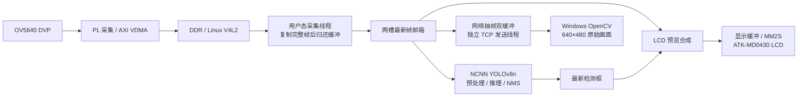

# Zynq-7020 边缘视觉：Linux 人脸检测与 LCD / PC 双端预览

在正点原子 STUDYBOARD Zynq-7020 上，将 OV5640 摄像头接入 Linux V4L2，
使用 NCNN 在 ARM Cortex-A9 上执行 YOLOv8n 人脸检测，并同时提供
ATK-MD0430 LCD 预览与以太网 PC 视频显示。

**已经实物跑通：摄像头采集 → Linux 抓帧 → 板端人脸检测 → LCD 叠框，
以及同一采集流 → 网口 → Windows 实时预览。**

本项目以 [luyixdu/ZYNQ_ov5640_hdmi_frame_difference](https://github.com/luyixdu/ZYNQ_ov5640_hdmi_frame_difference)
的摄像头、VDMA、HDMI 帧差实验为起点，保留其相关源码及版权声明。
本仓库重点记录在 STUDYBOARD 上完成的硬件适配、Linux 驱动、用户态推理、
LCD 后端、网络传输和板端验证。原始设计的说明与示例图请参阅上游；
下面的功能与性能均针对本项目当前 Linux 支线。

文档更新：2026-10-28。最近一次归档的网口联合实测：2026-10-16。

## 这次扩展解决了什么

摄像头采集约 28.5 帧/秒，而 Cortex-A9 上的检测速度明显更慢。
如果每次取帧都等模型算完，摄像头、显示和网络就容易一起积压。
本项目把它们分成不同的处理路径：

- **V4L2 采集**：将 PL/VDMA 的图像通过 `/dev/video0`、MMAP、QBUF/DQBUF
  交给用户态，检查帧序号和有效字节数。
- **只处理最新帧**：采集线程及时归还 V4L2 缓冲，用两槽邮箱向推理线程
  提供最新完整图像；慢推理主动跳过过时帧。
- **LCD 连续预览**：使用独立显示缓冲和持续运行的 MM2S 通路，
  支持推理原图叠框和“新画面 + 最新检测框”两种模式。
- **网口独立发送**：复用同一个采集进程，用网络专用双缓冲与发送线程
  抽帧传输；PC 断开或发送超时时回到等待连接状态。
- **成套构建与恢复**：提供传感器初始化、驱动、模型、交叉编译、
  SD 持久化试验目录、校验和回退操作说明。

这里的“实时预览”指画面持续更新。**采集、LCD 发布、PC 显示与模型推理的
帧率分别统计，不能将 28.59 fps 写成人脸检测速度。**

## 与上游项目的区别

下表的上游侧依据其 README 描述；保留的历史源码不代表当前 Linux 主线仍以
帧差算法做人脸检测。

| 维度 | 上游展示主线 | 本项目当前扩展 |
| --- | --- | --- |
| 任务 | 帧差法运动目标检测 | 训练后的单类人脸检测 |
| 算法执行 | PL 中的帧差逻辑 | PS 上的 NCNN / YOLOv8n；预处理、NMS 与坐标还原 |
| 软件接口 | SDK 裸机摄像头与 VDMA 控制 | PetaLinux、平台驱动与 V4L2 MMAP |
| 本地显示 | HDMI | ATK-MD0430 / NT35510，8080 16 位 LCD |
| 并发处理 | 原有视频处理链路 | 采集、慢速推理、LCD 预览、TCP 发送分开处理 |
| 电脑显示 | README 未展示此功能 | Windows Python / OpenCV 网口接收显示 |
| 验证材料 | 原工程示例 | 本项目帧完整性、处理耗时、长测、重启与断电恢复记录 |

## 当前系统数据流



- 传感器配置为 RGB565 DVP；当前 Linux 采集接口输出 **640×480 BGR24**，
  每帧 921600 字节。
- `preview` 模式让新画面复用最近完成的检测框；它不会每个显示帧都重新推理。
- 网络当前发送原始图像，**PC 尚未叠加人脸框**；LCD 保留检测框。
- 驱动限制一个 V4L2 采集持有者，因此显示与传输由同一个应用复用图像，
  不额外启动第二个 `/dev/video0` 读取进程。
- 20 字节 `SBV1` 帧头用于描述尺寸、BGR3 像素格式、源帧序号和负载长度。
  这是自定义 TCP 图像流，尚不是 RTSP、MJPEG 或 H.264 视频流。

## 已有实测结果

以下记录来自开发者提供的终端日志及实物观察，并非本次改文档重新测试。

**摄像头 + LCD + 网口联合测试（2026-10-16）**

| 指标 | 实测记录 | 含义 |
| --- | --- | --- |
| 采集总量 / 时长 | 6109 帧 / 213.710 秒 | 约 3 分 34 秒连续运行 |
| 摄像头采集 | **28.59 fps** | V4L2 完整帧吞吐 |
| 帧序号缺口 / 异常负载 | **0 / 0** | 此次采集完整性检查通过 |
| LCD 新画面发布 | 3040 次，约 **14.22 次/秒** | 不等同于 LCD 面板扫描频率 |
| PC 视频显示 | 约 **4.76–4.77 fps** | 每 6 个采集帧抽样 1 帧 |
| NCNN 平均纯推理耗时 | **1153.67 ms** | 耗时倒数约 0.87 次/秒 |
| 网络采样 / 完整发送 | 403 / 399 帧 | 仅统计 PC 已连接期间的采样 |
| 网络待发帧覆盖 | 1 次 | 新画面替代过时待发帧 |
| 实物观察 | LCD 与 PC 均正常显示 | 已由开发者确认 |

本次摘要未保留启动时完整的模型尺寸与线程参数行，不能用它直接做不同模型
或“开网/关网”的严格性能对比。完整摘要与统计口径见
[联合测试记录](docs/validation/network-joint-run-2026-10-16.md)。

**其他已完成的验证**

- 320 输入的 LCD preview 包曾完成 **9000 帧 / 314.828 秒**长测，
  采集 28.59 fps，序号缺口和异常负载均为 0，LCD 全程更新。
- 已确认正常重启、断电再上电后的**手动启动**能够检测并显示；
  开机自启服务尚未配置。
- 同一模型的 192 / 224 / 256 / 320 输入已有速度对照与现场目视试验。
  历史单次对照中 192 输入达到约 2.61 次/秒，具体场景与测试边界见
  [开发记录](studyboard_face_lcd_devlog_2026-10-12.md)和[模型说明](models/README.md)。
  该结果不代表所有输入尺寸、网络状态和画面场景下的统一性能。

## 硬件与软件

| 部分 | 本项目使用内容 |
| --- | --- |
| 主控 | 正点原子 STUDYBOARD，XC7Z020-2CLG400 |
| 摄像头 | OV5640，DVP 接口，SCCB/I²C 配置 |
| LCD | ATK-MD0430 V2.0，NT35510，8080 16 位接口 |
| PL | 摄像头接收、自定义显示逻辑、AXI VDMA 与 DDR 通路 |
| Linux | PetaLinux 2020.2 配套驱动、设备树片段与用户态程序 |
| 板端推理 | NCNN 20260526，ARM NEON，双线程版本使用 simpleomp |
| 训练与导出 | YOLOv8n；记录的 Ultralytics 8.4.135 / pnnx 20260526 |
| PC 接收 | Windows、Python、NumPy、OpenCV |

Vivado 2018.3 的早期工程与 2020.2 的后续构建脚本分别保留。
新机器复现应先核对实际 XSA、内核、SDK 和 SD 运行包的对应关系，
见[版本关系说明](docs/studyboard-face-lcd/09-版本关系与安全修改指南.md)。

## 模型与工程实现

仓库包含已训练的 `best.pt` 和四档 NCNN 导出，模型文件均附 SHA256 校验：

| 输入尺寸 | NCNN 输出形状 | 文件 |
| --- | --- | --- |
| 320×320 | `[1,5,2100]` | [320 模型](models/face_yolov8n/320/) |
| 256×256 | `[1,5,1344]` | [256 模型](models/face_yolov8n/256/) |
| 224×224 | `[1,5,1029]` | [224 模型](models/face_yolov8n/224/) |
| 192×192 | `[1,5,756]` | [192 模型](models/face_yolov8n/192/) |

模型输入包含 BGR→RGB、letterbox、CHW float32 和 `1/255` 归一化，
输出经置信度筛选、单类 NMS 后还原到摄像头坐标。
**人脸框由 PS 上的 CPU 推理产生，当前没有实现 PL 神经网络加速器。**

小规模数据集上的 mAP 只作为模型对照记录；多人、遮挡、低光和远距离小人脸
仍需更多现场验证。训练集与完整训练过程未随源码仓库打包，详细来源和精度
记录见[模型目录](models/README.md)。

## 从源码到运行

```sh
git clone https://github.com/askjc33/zynq-ov5640-face-lcd.git
cd zynq-ov5640-face-lcd
```

首次复现请按[技术手册入口](docs/studyboard-face-lcd/README.md)准备硬件、
PetaLinux 项目、ARM SDK、NCNN 和相匹配的内核模块。
本仓库保存源码、模型与说明；完整 Ubuntu/PetaLinux 工作区、SD 启动镜像、
已编译 ELF 和 `.ko` 等运行物需要按手册另外构建或归档。

已有已验证 SD 运行包时，可在开发板上执行下例。目录名是历史试验包示例，
应先确认自己的包中具备脚本、驱动、运行库和相应模型：

```sh
cd /media/sd-mmcblk0p2/face-lcd-network-trial-20261016
STUDYBOARD_LCD_MODE=preview STUDYBOARD_MODEL_SIZE=320 STUDYBOARD_STREAM_PORT=5000 STUDYBOARD_STREAM_STRIDE=6 sh ./start-face-lcd.sh 0
```

`0` 表示持续运行，`Ctrl-C` 后程序会清理采集与显示资源并打印统计。
启动脚本记录 Linux boot ID，按已验证顺序处理传感器与驱动。

PC 与开发板处于同一网段后，在仓库根目录用已有 NumPy/OpenCV 环境运行：

```sh
python linux/studyboard_ncnn_face/pc_video_viewer.py --host 192.168.10.2 --port 5000
```

开发板 IP 是此前直连配置的示例；PC 窗口按 `Q` 或 `Esc` 退出。
完整构建、上传、模型选择与回退步骤见
[LCD 部署说明](linux/studyboard_ncnn_face/LCD_部署说明.md)和
[网络部署教程](linux/studyboard_ncnn_face/NETWORK_部署说明.md)。

## 关键文件从哪里读

| 路径 | 负责内容 |
| --- | --- |
| [`studyboard-frame-capture.c`](linux/studyboard_frame_capture/studyboard-frame-capture.c) | 平台驱动、DMA、V4L2 缓冲管理与 LCD 用户态接口 |
| [`studyboard-ncnn-face.cpp`](linux/studyboard_ncnn_face/studyboard-ncnn-face.cpp) | 采集主循环、最新帧邮箱、推理线程与预览调度 |
| [`face_detector.cpp`](linux/studyboard_ncnn_face/face_detector.cpp) | NCNN 加载、预处理、推理、NMS 与坐标变换 |
| [`lcd_output.cpp`](linux/studyboard_ncnn_face/lcd_output.cpp) | 完整图像上传、LCD 提交与停止 |
| [`video_stream_server.cpp`](linux/studyboard_ncnn_face/video_stream_server.cpp) | TCP 监听、网络双缓冲、超时和断线处理 |
| [`pc_video_viewer.py`](linux/studyboard_ncnn_face/pc_video_viewer.py) | 精确接收帧头/负载、NumPy 图像重组与窗口显示 |
| [`start-face-lcd.sh`](linux/studyboard_ncnn_face/start-face-lcd.sh) | 启动预检、一次初始化、驱动与检测流程衔接 |
| [`ov5640-init.c`](linux/ov5640_init/ov5640-init.c) | SCCB 寄存器初始化、逐寄存器重试与读回验证 |

`rtl/`、`bringup/`、`constraints/`、`scripts/` 保存 PL 源码、仿真、
引脚和工程重建脚本；`ip_repo/`、`ov5640_hdmi.srcs/`、`SDK/` 保留原始
设计基础；`docs/` 提供架构、排错、运行操作与逐层读源码手册。

## 后续计划与当前边界

- [ ] 增加真实硬件总览、LCD 叠框、PC 联合显示照片和连续演示视频。
- [ ] 补齐相同条件下的模型尺寸、开网/关网和长期运行对照。
- [ ] 增加 PC 端检测框输出，区分推理帧与预览帧的时间关系。
- [ ] 评估 JPEG/MJPEG 编码的带宽收益与 Cortex-A9 CPU 开销。
- [ ] 评估标准 RTSP 推流/拉流；当前 5000 端口不能直接作为 RTSP 地址。
- [ ] 在更充分的场景与数据划分上验证检测精度，再考虑模型优化。
- [ ] 整理版本固定、可回退的开机启动服务。

照片、视频和新的测试结果应使用本项目实物产生的材料；
现有实测文字已可复核，尚未上传的照片不会用上游演示图代替。
补充材料的具体要求见[展示素材与测试清单](docs/project-media-and-tests.md)。

## 来源与致谢

感谢 [luyixdu/ZYNQ_ov5640_hdmi_frame_difference](https://github.com/luyixdu/ZYNQ_ov5640_hdmi_frame_difference)
提供的原始 OV5640、VDMA、HDMI 帧差实验基础。SDK 与自定义 IP 中还保留
Xilinx/AMD、Digilent、正点原子等来源的文件声明。
本项目的 Linux 人脸检测、LCD 与网络扩展通过上文所列代码和验收记录单独说明。
不同来源文件的许可不能相互替代，详见[第三方说明](THIRD_PARTY_NOTICES.md)。
